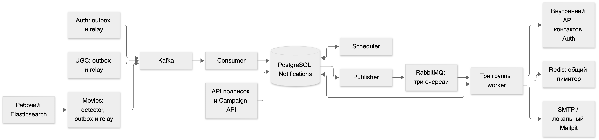

https://github.com/feodal01/notifications_sprint_1

# Дипломный проект: Биллинг подписок

Тема диплома — **«Биллинг»**: платная подписка на фильмы-новинки онлайн-кинотеатра. Новый сервис [`services/billing`](services/billing/README.md) встроен в существующий проект и связан с Auth, Notifications, Django Admin и ЮKassa (тестовый магазин, API v3).

**Документы для ревью:**

- [ТЗ](docs/billing/tz.md) содержит требования, инварианты, матрицу деградации, решения и ограничения.
- [Тезисы защиты и сценарий демо](docs/billing/defense.md).
- [План работ](docs/billing/plan.md).
- [Диаграммы](docs/diagrams/billing/README.md): C4, ER, последовательности.
- Видео демо: [покупка](docs/billing/demo/billing-demo-1-subscription-purchase.webm) и [возврат из админки](docs/billing/demo/billing-demo-2-admin-refund.webm).

### Что умеет

- **Покупка подписки.** Пользователь оплачивает подписку картой на странице ЮKassa. Тариф по умолчанию — «Премиум», 30 дней, 299 ₽. Название, цена и срок берутся из таблицы `tariffs`. Сразу после оплаты Auth выдаёт роль `subscriber` с `expires_at`, и фильмы младше 3 лет становятся доступны. Доступ закрывается сам, когда подписка кончается.
- **Нет двойных списаний и двойных возвратов.** Двойной клик или повтор запроса не создаёт второй платёж, а повторное подтверждение не оформляет второй возврат. Это держат три механизма:
  - advisory-lock на пользователя;
  - частичные уникальные индексы, которые разрешают только один `pending` платёж и только один активный возврат;
  - `Idempotence-Key` в ЮKassa с учётом его срока жизни 24 ч.
- **Статус только из ЮKassa.** Billing не доверяет телу вебхука. Итоговый статус он читает через `GET` в ЮKassa и сверяет сумму, валюту и `metadata`. Кроме того, `billing-worker` сам сверяет незавершённые операции, поэтому всё работает и без входящего вебхука.
- **Гарантированная доставка в Auth и Notifications.** Задачи пишутся в transactional outbox в той же транзакции, что и платёж. Дальше они повторяются с backoff, а если повторы не помогают, задача попадает в «требует вмешательства». Версии доступа в Auth и заранее записанная отмена письма в Notifications защищают от гонок.
- **Письма.** Notifications отправляет четыре транзакционных письма в Mailpit: об оплате, об отказе в оплате, об окончании подписки и о возврате. Письмо об окончании планируется на `ends_at` и отменяется при возврате.
- **Админка для поддержки.** Django Admin работает только через внутренний API Billing и не подключается к его БД. В ней есть:
  - списки подписок и платежей;
  - фильтры «Зависшие операции» и «Не доставлено»;
  - карточка платежа с историей переходов и задачами outbox;
  - полный возврат с обязательной причиной;
  - кнопка «Проверить в ЮKassa»;
  - ручной повтор и закрытие задач доставки;
  - неизменяемый журнал действий администраторов.
- **Управляемая деградация.** Если падает Auth, Notifications или ЮKassa, оплата и возврат всё равно фиксируются, а последствия доставляются после восстановления зависимости. Админка без Auth показывает UUID пользователя и время в UTC. Если недоступен `auth-redis`, проверка прав читает роли из PostgreSQL.
- **Мониторинг.** Сигналы уходят в GlitchTip и в `ERROR`-лог:
  - коды 4xx от ЮKassa;
  - статус `waiting_for_capture`;
  - расхождение суммы или `metadata`;
  - задачи outbox в состоянии «требует вмешательства»;
  - зависшие операции.

  Кроме того, `billing-api` и `billing-worker` пишут трассы в Jaeger.

### Ограничения MVP

- Один активный тариф. Нет автопродления, сохранённых карт и покупки впрок: пока текущая подписка действует, новая покупка отвечает `409`.
- Возврат только полный, только через админку и только для платежа текущей подписки.
- Стенд локальный, вебхуки из интернета до него не доходят. Итог платежа Billing узнаёт сверкой. Для демо есть скрипт `emulate_webhook`.
- Завершённые платежи повторно не сверяются. Возврат, сделанный в кабинете ЮKassa в обход админки, Billing не увидит, и регламент поддержки такие возвраты запрещает.
- Тариф меняется только в таблице `tariffs` в `billing-db`. Ни в админке, ни в API этого делать нельзя. Новая цена действует на новые покупки, уже оплаченные платежи не меняются.
- Все внутренние сервисы ходят друг к другу с одним общим `SERVICE_API_KEY`. Сеть Compose считается доверенной.
- Если операцию не находит сам провайдер (`4xx` на `GET`), она остаётся незавершённой и уходит в мониторинг на ручной разбор.

Полный список ограничений и путь масштабирования описан в [ТЗ, раздел 7.2](docs/billing/tz.md#72-ограничения-спроектированной-архитектуры-и-запас-гибкости).

### Как быстро проверить

1. Добавьте в `.env` тестовые ключи магазина ЮKassa (`YOOKASSA_SHOP_ID`, `YOOKASSA_SECRET_KEY`) и поднимите стенд командами из раздела [Запуск](#запуск).
2. Зарегистрируйте пользователя:
   ```bash
   curl -X POST http://localhost/api/v1/auth/signup -H 'Content-Type: application/json' -d '{"login":"reviewer1","password":"Reviewer-Billing-2026!","tz":"Europe/Moscow"}'
   ```
   Затем откройте **http://localhost/billing/** и войдите под ним.
3. Нажмите «Оформить» и оплатите тестовой картой `5555 5555 5555 4444` (срок — любая будущая дата, CVC — любой). Если ЮKassa недоступна или не хочется ждать сверки, отправьте вебхук вручную:
   ```bash
   docker compose exec billing-api python -m emulate_webhook --id <provider_payment_id> --event payment.succeeded --base-url http://127.0.0.1:8000
   ```
4. Посмотреть результат можно в трёх местах:
   - письма — **http://localhost:8025** (Mailpit);
   - админка — **http://localhost/admin/** (логин `admin`, пароль `Cinema-Admin-2026!`), раздел «Биллинг»; там же есть возврат;
   - Swagger Billing — **http://localhost/billing/docs**.
5. Автотесты:
   - юнит-тесты Billing: `uv run --directory services/billing pytest -m "not integration"`;
   - полный сквозной прогон в Docker (сценарии `T-06`…`T-37` из ТЗ): `./tests/integration/run_billing_integration.sh`.

---

# Онлайн-кинотеатр

Репозиторий содержит Admin, Auth, Billing, Movies API, Movies ETL, UGC Events, UGC ETL, UGC API и Notifications. Корневой Docker Compose запускает приложения и общую инфраструктуру. Nginx принимает весь внешний HTTP-трафик. Jaeger принимает трассы сервисов. ELK собирает логи приложений и Nginx, GlitchTip — ошибки приложений. Kafka и ClickHouse обслуживают события зрителя. MongoDB хранит закладки, лайки и рецензии.

## Запуск

Выполните команды из корня репозитория:

```bash
cp .env.example .env
docker compose up -d --build
docker compose run --rm notifications-limiter-init
docker compose ps
```

Файл `.env.example` содержит значения для локального запуска всего проекта через Compose. Замените пароли и секреты перед использованием в другом окружении.

Письма Notifications принимает локальный Mailpit; открыть их можно на **http://localhost:8025**.
Внешний SMTP и файл `smtp.env` для локального запуска не нужны. Команда limiter-init выше
разрешает отправку после начальной паузы 60 секунд; повторный запуск не сбрасывает лимиты.
[Короткий запуск для ревью и проверка welcome-письма](services/notifications/README.md#локальный-запуск-для-ревью)
поднимает только Auth, Notifications и необходимые зависимости. Для дайджестов сначала
выполните [первичную загрузку](docs/diagrams/notifications-arch/ROLLOUT.md).

Контакты пользователей хранит Auth; Notifications запрашивает их через внутренний API
при подготовке письма. Новые пользователи должны явно передавать часовой пояс `tz`.
Для существующей установки перед обновлением выполните
[переход на новую схему](docs/diagrams/notifications-arch/ROLLOUT.md#переход-на-контакты-в-auth-и-обязательный-tz).

ELK (`elk-elasticsearch`, `logstash`, `kibana`, `kibana-bootstrap`, `filebeat`) и GlitchTip (`glitchtip`, `glitchtip-bootstrap`, `sentry-db`, `sentry-redis`) входят в профиль `observability` и командой выше не запускаются. Чтобы поднять проект вместе с ними:

```bash
docker compose --profile observability up -d --build
```

Профиль добавляет около 2,5 ГБ памяти. Для запуска всего проекта с профилем выделите Docker не меньше 12 ГБ (Docker Desktop: **Settings → Resources → Memory**); при 8 ГБ оба Elasticsearch завершаются по нехватке памяти (код 137) и перезапускаются по кругу.

Профиль можно включить и для уже запущенного проекта той же командой. Остановить только его сервисы: `docker compose --profile observability stop elk-elasticsearch logstash kibana filebeat glitchtip sentry-db sentry-redis`.

## Сервисы

| Сервис | Назначение | Данные и зависимости | Подробное описание |
| --- | --- | --- | --- |
| Admin | Управляет каталогом, ролями и подписками/возвратами биллинга через Django Admin; проверяет вход и административное право через Auth | Записывает каталог и технические записи пользователей в `theatre-db`; читает и изменяет данные биллинга через внутренний API `Billing` и `Auth` | [README Admin](services/admin/README.md) |
| Auth | Регистрирует пользователей, поддерживает вход по паролю и через Яндекс ID, выдаёт токены, отзывает все сессии при смене пароля, управляет правами (включая срочную роль `subscriber` с `expires_at`) и ограничивает запросы; хранит историю входов в [16 hash-секциях](services/auth/README.md#партиционирование-истории-входов) | Использует `auth-db` и `auth-redis`; обращается в Yandex OAuth | [README Auth](services/auth/README.md) |
| Billing | Оформляет подписку «Премиум» через ЮKassa, сверяет статусы платежей и возвратов (`billing-api` + `billing-worker`), синхронизирует доступ к новинкам в Auth, отправляет и отменяет транзакционные письма в Notifications и предоставляет внутренний API для поддержки в Admin | Использует `billing-db` (`PostgreSQL 16`, `synchronous_commit=on`), обращается в ЮKassa API v3, Auth и Notifications Campaign API | [README Billing](services/billing/README.md), [ТЗ Биллинга](docs/billing/tz.md) |
| Movies API | Возвращает список фильмов, результаты поиска и карточки фильмов | Читает Elasticsearch, использует `movies-redis` и проверяет доступ к полной карточке через Auth | [README Movies API](services/movies-api/README.md) |
| Movies ETL | Переносит изменения каталога из PostgreSQL в Elasticsearch | Читает `theatre-db`; хранит состояние обработки в SQLite | [README Movies ETL](services/movies-etl/README.md) |
| UGC Events | Принимает пакеты действий зрителя и публикует их в Kafka | Пишет в топик `ugc.events`; проверяет access JWT локально | [README UGC Events](services/ugc-events/README.md) |
| UGC ETL | Читает Kafka и записывает события в ClickHouse через `aiochclient` | Читает `ugc.events`; пишет в распределённую `ugc.events`; невалидные сообщения уходят в `ugc.events.dlq` | [README UGC ETL](services/ugc-etl/README.md) |
| UGC API | Закладки, лайки (оценки 0…10) и рецензии фильмов; FastAPI + Beanie на асинхронном PyMongo | Читает и пишет MongoDB через `mongos1`, `mongos2`; проверяет access JWT локально | [README UGC API](services/ugc-api/README.md) |
| Notifications | Пользовательские подписки, кампании и доставка писем | PostgreSQL, Kafka, RabbitMQ, Redis; локальный SMTP Mailpit | [README Notifications](services/notifications/README.md) |
| Mailpit | Принимает локальные письма Notifications и показывает их в браузере | SMTP `notifications-mailpit:1025`; без внешней пересылки | `http://localhost:8025` |
| Kafka | Хранит события зрителя до загрузки в ClickHouse | Тома `kafka_0_data`, `kafka_1_data`, `kafka_2_data`; топики создаёт `kafka-init` | Раздел [События зрителя](#события-зрителя) |
| Kafka UI | Показывает топики и сообщения Kafka | Не хранит бизнес-данные | `http://localhost:8080` |
| ZooKeeper | Координация реплик ClickHouse | Без постоянного тома; слушает `2181` внутри сети | Раздел [События зрителя](#события-зрителя) |
| ClickHouse | Хранит события зрителя и агрегаты просмотров | Кластер `company_cluster`: два шарда по две реплики (`clickhouse-node1`…`4`); тома `clickhouse_node1_data`…`clickhouse_node4_data`; схема `infra/clickhouse/init.sql` | Раздел [События зрителя](#события-зрителя) |
| MongoDB | Хранит закладки, лайки и рецензии | Шардированный кластер: два шарда `mongors1` и `mongors2` по три реплики, replica set конфиг-серверов `mongors1conf`, роутеры `mongos1` и `mongos2`; тома `mongors1n1_data`…`mongors2n3_data`, `mongocfg1_data`…`mongocfg3_data`; кластер собирает `mongo-init` скриптом `infra/mongo/init-cluster.sh` | Раздел [MongoDB](#mongodb) |
| Jaeger | Принимает и показывает трассы Auth | Хранит трассы в памяти; не хранит бизнес-данные | Раздел [Трассировка Auth](#трассировка-auth) |
| ELK (профиль `observability`) | Хранит и показывает логи Auth, Movies API, UGC Events, UGC API, UGC ETL и Nginx | `elk-elasticsearch` (отдельно от поискового `elasticsearch`), `logstash`, `kibana`, `kibana-bootstrap`, `filebeat`; тома `elk_elasticsearch_data`, `filebeat_data`, `nginx_logs`; конфиги `infra/logstash`, `infra/filebeat`, `infra/kibana`; ротация файлов Nginx — `nginx-logrotate` вне профиля | Раздел [Логи и ошибки](#логи-и-ошибки) |
| GlitchTip (профиль `observability`) | Принимает ошибки тех же пяти FastAPI-сервисов по протоколу Sentry | `glitchtip`, `glitchtip-bootstrap`, `sentry-db`, `sentry-redis`; том `sentry_db_data` | Раздел [Логи и ошибки](#логи-и-ошибки) |

Nginx работает как единый gateway. PostgreSQL, Redis, Elasticsearch, Kafka, ClickHouse, ZooKeeper, MongoDB и Jaeger работают как инфраструктурные контейнеры. Movies API и gateway не зависят от состояния фонового Movies ETL. Gateway ждёт готовности UGC Events и UGC API и не зависит от состояния UGC ETL.

## Конфигурация

### Запуск через Docker Compose

Docker Compose читает корневой `.env`. Файл `.env.example` является шаблоном для этого файла. Код сервисов не загружает корневой `.env` напрямую.

Блоки `environment` в `compose.yaml` передают значения в контейнеры:

| Переменные корневого `.env` | Получатель | Результат |
| --- | --- | --- |
| `GATEWAY_PORT` | `gateway` | Внешний порт Nginx; внутренний порт равен `80` |
| `JAEGER_UI_PORT`, `JAEGER_OTLP_HTTP_PORT` | `jaeger` | Публикуют Jaeger UI и OTLP/HTTP на `127.0.0.1` |
| `KIBANA_PORT` | `kibana` | Публикует Kibana на `127.0.0.1`; по умолчанию `5601` |
| `SENTRY_DB_USER`, `SENTRY_DB_PASSWORD`, `SENTRY_DB_NAME`, `SENTRY_SECRET_KEY` | `sentry-db`, `glitchtip`, `glitchtip-bootstrap` | База и секретный ключ GlitchTip |
| `SENTRY_ADMIN_EMAIL`, `SENTRY_ADMIN_PASSWORD` | `glitchtip-bootstrap` | Администратор GlitchTip; пароль задаётся только при создании |
| `SENTRY_PORT` | `glitchtip` | Публикует GlitchTip на `127.0.0.1`; по умолчанию `9000` |
| `SENTRY_DSN`, `SENTRY_ENVIRONMENT`, `SENTRY_TRACES_SAMPLE_RATE` | Auth, Billing (`billing-api`, `billing-worker`), Movies API, UGC Events, UGC API, UGC ETL | DSN проекта GlitchTip (проект с этим id и ключом создаёт `glitchtip-bootstrap`), окружение и доля трасс; пустой DSN выключает отправку ошибок |
| `THEATRE_POSTGRES_USER`, `THEATRE_POSTGRES_PASSWORD`, `THEATRE_POSTGRES_DB` | `theatre-db`, Admin, Movies ETL | Передаются как `POSTGRES_USER`, `POSTGRES_PASSWORD`, `POSTGRES_DB` |
| `THEATRE_SQL_OPTIONS` | Admin | Передаётся как `SQL_OPTIONS` |
| `AUTH_POSTGRES_USER`, `AUTH_POSTGRES_PASSWORD`, `AUTH_POSTGRES_DB` | `auth-db`, миграции Auth, Auth | Передаются как `POSTGRES_USER`, `POSTGRES_PASSWORD`, `POSTGRES_DB` |
| `ADMIN_DEBUG`, `ADMIN_SECRET_KEY` | Admin и его служебные процессы | Передаются как `DEBUG`, `SECRET_KEY` |
| `AUTH_ADMIN_LOGIN`, `AUTH_ADMIN_PASSWORD`, `AUTH_ADMIN_TZ` | `auth-bootstrap` | Создают начального суперпользователя Auth или повышают существующего пользователя с тем же логином; `AUTH_ADMIN_TZ` задаёт обязательный часовой пояс IANA, например `Europe/Moscow` |
| `AUTH_CLIENT_CONNECT_TIMEOUT_SECONDS`, `AUTH_CLIENT_REQUEST_TIMEOUT_SECONDS` | Admin | Ограничивают ожидание внутренних запросов Admin к Auth |
| `AUTH_CLIENT_BACKOFF_MAX_TRIES`, `AUTH_CLIENT_BACKOFF_MAX_TIME_SECONDS` | Admin | Ограничивают безопасные повторы внутренних запросов Admin к Auth |
| `JWT_SECRET`, `JWT_ALGORITHM`, `SERVICE_API_KEY` | Auth, Admin, Billing (`billing-api`, `billing-worker`), Movies API, UGC Events и UGC API | Auth выпускает JWT и проверяет сервисный ключ; Admin и Billing подписывают внутренние вызовы сервисным ключом `SERVICE_API_KEY`; Billing, Movies API, UGC Events и UGC API проверяют access JWT |
| `CLICKHOUSE_USER`, `CLICKHOUSE_PASSWORD` | Четыре узла ClickHouse и UGC ETL | Один пользователь на всех нодах; пароль также задаёт `secret` кластера и учётные данные реплик в `infra/clickhouse/config.d/cluster.xml`. Базу `ugc` создаёт UGC ETL запросом `ON CLUSTER` |
| `MONGO_SHARD_CACHE_SIZE_GB` | Шесть узлов шардов MongoDB | Размер кэша WiredTiger каждого узла шарда в гигабайтах; по умолчанию `0.5`. Конфиг-серверы используют `0.25` |
| `ACCESS_TOKEN_TTL_SECONDS`, `REFRESH_TOKEN_TTL_SECONDS`, `PASSWORD_*`, `AUTHORIZATION_CACHE_TTL_SECONDS` | Auth | Настройки токенов, паролей и RBAC-кэша |
| `AUTH_BACKOFF_*`, `AUTH_REDIS_*` | Auth | Передаются как `BACKOFF_*`, `REDIS_*` |
| `AUTH_TRACING_ENABLED`, `AUTH_TRACING_SERVICE_NAME`, `AUTH_TRACING_SAMPLE_RATE` | Auth | Включают трассировку, задают имя сервиса и долю сэмплинга; OTLP endpoint задан в Compose |
| `AUTH_YANDEX_OAUTH_*` | Auth | Включают вход через Яндекс, передают client ID, client secret, Redirect URI, TTL состояния, таймауты и параметры повторов |
| `AUTH_RATE_LIMIT_ENABLED`, `AUTH_RATE_LIMIT_<POLICY>_{RATE,WINDOW_SECONDS,CAPACITY}` | Auth | Включают Token Bucket и задают лимиты политик `LOGIN`, `SIGNUP`, `REFRESH`, `USER`, `ADMIN`, `SERVICE` |
| `ELASTICSEARCH_INDEX` | `elasticsearch-init`, Movies API, Movies ETL | Задаёт общий индекс `movies` |
| `ELASTICSEARCH_REQUEST_TIMEOUT`, `MOVIES_REDIS_*`, `MOVIES_BACKOFF_*`, `MOVIES_MAX_*` | Movies API | Параметры Elasticsearch, Redis, повторов и лимитов API |
| `MOVIES_AUTH_CONNECT_TIMEOUT`, `MOVIES_AUTH_REQUEST_TIMEOUT`, `MOVIES_AUTH_BACKOFF_*` | Movies API | Таймауты и ограниченный повтор внутреннего вызова Auth |
| `ETL_STATE_DATABASE_FILE_PATH`, `ETL_PRODUCER_BATCH_SIZE`, `ETL_WORKER_LEASE_SECONDS`, `ETL_JOB_MAX_ATTEMPTS`, `ETL_WORKER_POLL_INTERVAL_SECONDS`, `ETL_LOG_LEVEL`, `ETL_ELASTICSEARCH_TIMEOUT_SECONDS` | Movies ETL | Передаются без префикса `ETL_` |
| `ETL_POSTGRES_BACKOFF_*`, `ETL_ELASTICSEARCH_BACKOFF_*` | Movies ETL | Передаются как `POSTGRES_BACKOFF__*`, `ELASTICSEARCH_BACKOFF__*` |
| `BILLING_POSTGRES_USER`, `BILLING_POSTGRES_PASSWORD`, `BILLING_POSTGRES_DB` | `billing-db`, `billing-migrate`, `billing-api`, `billing-worker` | База данных сервиса Billing (`billing-db`) |
| `PAYMENT_PROVIDER_ACTIVE` | `billing-api`, `billing-worker` | Код платёжного провайдера для новых платежей (`yookassa`); начатые платежи и возвраты идут через провайдера, записанного в операции |
| `YOOKASSA_SHOP_ID`, `YOOKASSA_SECRET_KEY`, `YOOKASSA_API_BASE_URL`, `YOOKASSA_TIMEOUT_SECONDS` | `billing-api`, `billing-worker` | Учётные данные и параметры подключения к ЮKassa API v3 |
| `BILLING_PUBLIC_BASE_URL`, `RECONCILE_MIN_AGE_SECONDS`, `BILLING_RECONCILE_INTERVAL_SECONDS`, `BILLING_OUTBOX_INTERVAL_SECONDS`, `BILLING_OUTBOX_MAX_ATTEMPTS`, `BILLING_STUCK_THRESHOLD_SECONDS` | `billing-api`, `billing-worker` | Публичный базовый URL для `return_url` и ссылок в письмах, интервалы фоновой сверки и доставки `outbox_tasks`, порог зависших операций |
| `BILLING_TRACING_ENABLED`, `BILLING_TRACING_SERVICE_NAME`, `BILLING_TRACING_SAMPLE_RATE` | `billing-api`, `billing-worker` | Включают трассировку OpenTelemetry, задают имя сервиса и долю сэмплинга для экспорта в Jaeger |
| `NOTIFICATIONS_CAMPAIGN_API_KEY` | `notifications-campaign-api`, `billing-api`, `billing-worker` | Сервисный ключ `X-API-Key` внутреннего Campaign API для отправки и отмены писем биллинга |
| `BILLING_INTERNAL_URL` | Admin | Внутренний адрес API сервиса Billing (`http://billing-api:8000/api/v1/internal/billing`, задаётся в `compose.yaml`) |

#### Внутренняя сеть

Контейнеры обращаются к зависимостям по именам сервисов Docker Compose:

| Зависимость | Внутренний адрес |
| --- | --- |
| PostgreSQL каталога и Admin | `theatre-db:5432` |
| PostgreSQL Auth | `auth-db:5432` |
| PostgreSQL Billing | `billing-db:5432` |
| HTTP API Billing | `billing-api:8000` |
| Redis Auth | `auth-redis:6379` |
| Redis Movies API | `movies-redis:6379` |
| Elasticsearch | `elasticsearch:9200` |
| Kafka | `kafka-0:9092,kafka-1:9092,kafka-2:9092` |
| ClickHouse HTTP | `clickhouse-node1:8123` (ETL подключается сюда) |
| ClickHouse native | `clickhouse-node1:9000`…`clickhouse-node4:9000` |
| ZooKeeper | `zookeeper:2181` |
| MongoDB (mongos) | `mongos1:27017`, `mongos2:27017` |
| Jaeger OTLP/HTTP | `jaeger:4318` |
| Logstash: логи приложений (UDP, JSON) | `logstash:5044` |
| Logstash: Beats от filebeat | `logstash:5045` |
| GlitchTip (приём событий SDK) | `glitchtip:8000` |

#### Публикация портов

- Nginx принимает внешний трафик на порту `GATEWAY_PORT`.
- PostgreSQL, Redis и Elasticsearch доступны только внутри сети Docker Compose.
- Jaeger UI и OTLP/HTTP доступны на хосте только через `127.0.0.1`.
- Kibana (`KIBANA_PORT`) и GlitchTip (`SENTRY_PORT`) доступны на хосте только через `127.0.0.1`. Elasticsearch ELK и Logstash наружу не публикуются.
- ClickHouse HTTP доступен на хосте только через `127.0.0.1:8123` (узел `clickhouse-node1`). Native-порт `9000` и остальные HTTP-порты узлов наружу не публикуются.
- MongoDB доступна на хосте только через роутеры: `127.0.0.1:27019` (`mongos1`) и `127.0.0.1:27020` (`mongos2`). Узлы шардов и конфиг-серверы наружу не публикуются.
- Kafka UI доступен на порту `8080`. Внешние слушатели брокеров Kafka — `9094`, `9095` и `9096`.

#### Пароли PostgreSQL

PostgreSQL применяет `POSTGRES_PASSWORD` при первом создании базы в пустом томе Docker. Изменение пароля в корневом `.env` не меняет пароль в существующей базе.

### Постоянные данные

| Том Docker | Данные |
| --- | --- |
| `theatre_db_data` | Каталог фильмов и данные Admin |
| `auth_db_data` | Пользователи, внешние учётные записи, роли и история входов Auth |
| `billing_db_data` | Тарифы, платежи, подписки, возвраты, журнал переходов `operation_events`, журнал действий поддержки `admin_actions` и очередь `outbox_tasks` сервиса Billing (`synchronous_commit = on`) |
| `auth_redis_data` | Версии сессий, блокировки смены пароля, токены обновления, отозванные токены доступа, состояния OAuth, кэш прав и данные ограничения запросов Auth; Redis использует журнал Append Only File (AOF) |
| `elasticsearch_data` | Индекс фильмов |
| `movies_etl_state` | SQLite-состояние Movies ETL |
| `admin_static` | Статические файлы Django |
| `kafka_0_data` | Данные брокера `kafka-0` |
| `kafka_1_data` | Данные брокера `kafka-1` |
| `kafka_2_data` | Данные брокера `kafka-2` |
| `clickhouse_node1_data` | Шард 1, реплика `clickhouse-node1` |
| `clickhouse_node2_data` | Шард 1, реплика `clickhouse-node2` |
| `clickhouse_node3_data` | Шард 2, реплика `clickhouse-node3` |
| `clickhouse_node4_data` | Шард 2, реплика `clickhouse-node4` |
| `mongors1n1_data`, `mongors1n2_data`, `mongors1n3_data` | Шард MongoDB `mongors1`, три реплики |
| `mongors2n1_data`, `mongors2n2_data`, `mongors2n3_data` | Шард MongoDB `mongors2`, три реплики |
| `mongocfg1_data`, `mongocfg2_data`, `mongocfg3_data` | Метаданные кластера MongoDB, replica set `mongors1conf` |
| `elk_elasticsearch_data` | Индексы логов `app-*` и `nginx-*` |
| `nginx_logs` | Файлы Nginx для filebeat: `access-log.json` и `error-log.log`; ротирует `nginx-logrotate` |
| `filebeat_data` | Позиция чтения filebeat |
| `sentry_db_data` | Пользователи, проекты и ошибки GlitchTip |

ZooKeeper не имеет именованного тома. Схема таблиц не лежит в initdb узлов: UGC ETL выполняет `infra/clickhouse/init.sql` при старте (`ON CLUSTER company_cluster`).

`movies-redis` не имеет постоянного тома. Он хранит только кэш Movies API. После перезапуска этот кэш заполняется из Elasticsearch.

### Отдельный запуск сервиса

Каждый сервис имеет собственный шаблон:

| Сервис | Шаблон | Рабочий файл |
| --- | --- | --- |
| Admin | [services/admin/.env.example](services/admin/.env.example) | `services/admin/.env` |
| Auth | [services/auth/.env.example](services/auth/.env.example) | `services/auth/.env` |
| Billing | [services/billing/.env.example](services/billing/.env.example) | `services/billing/.env` |
| Movies API | [services/movies-api/.env.example](services/movies-api/.env.example) | `services/movies-api/.env` |
| Movies ETL | [services/movies-etl/.env.example](services/movies-etl/.env.example) | `services/movies-etl/.env` |
| UGC Events | [services/ugc-events/.env.example](services/ugc-events/.env.example) | `services/ugc-events/.env` |
| UGC ETL | [services/ugc-etl/.env.example](services/ugc-etl/.env.example) | `services/ugc-etl/.env` |
| UGC API | [services/ugc-api/.env.example](services/ugc-api/.env.example) | `services/ugc-api/.env` |

Скопируйте нужный `.env.example` в `.env` в том же каталоге. Сервисные `.env` не используются корневым Compose и не попадают в Git.

Локальные шаблоны используют `127.0.0.1` или `localhost`. PostgreSQL, Redis, Elasticsearch, Kafka, ClickHouse и MongoDB (`mongos` на `127.0.0.1:27019`, `27020`) для отдельного запуска должны быть доступны с хоста.

Запускайте Movies ETL из каталога `services/movies-etl`. ETL загружает `.env` из текущего рабочего каталога.

## Внешние маршруты

| Маршрут | Назначение |
| --- | --- |
| `http://localhost/admin/` | Django Admin |
| `http://localhost/billing/` | Экран пользователя «Моя подписка» (`Billing`) |
| `http://localhost/billing/login`, `/billing/logout`, `/billing/subscribe` | Вход, выход и оформление подписки (`Billing`) |
| `http://localhost/billing/payments/{id}`, `/billing/payments/{id}/continue` | Экран результата оплаты и продолжение оплаты (`Billing`) |
| `http://localhost/api/v1/billing/*` | Публичное API биллинга и вебхук ЮKassa |
| `http://localhost/billing/health` | Состояние Billing и `billing-db` |
| `http://localhost/billing/docs` | Swagger UI Billing |
| `http://localhost/billing/openapi.json` | OpenAPI JSON Billing |
| `http://localhost/static/admin/css/base.css` | Пример статического файла Django |
| `http://localhost/api/v1/auth/*` | Префикс маршрутов Auth API |
| `http://localhost/api/v1/auth/social/yandex/login?tz=Europe/Moscow` | Начать вход через Яндекс ID |
| `http://localhost/api/v1/films` | Movies API |
| `http://localhost/api/v1/ugc/events` | Пакет действий зрителя в Kafka |
| `http://localhost/api/v1/ugc/*` | UGC API: оценки, закладки, рецензии (кроме `/api/v1/ugc/events`) |
| `http://localhost/admin/health` | Состояние Admin |
| `http://localhost/auth/health` | Состояние Auth |
| `http://localhost/movies/health` | Состояние Movies API |
| `http://localhost/ugc/health` | Состояние UGC Events и Kafka |
| `http://localhost/ugc-api/health` | Состояние UGC API и MongoDB |
| `http://localhost/ugc-etl/health` | Состояние UGC ETL, Kafka и ClickHouse |
| `http://localhost/auth/docs` | Swagger UI Auth |
| `http://localhost/movies/docs` | Swagger UI Movies API |
| `http://localhost/ugc/docs` | Swagger UI UGC Events |
| `http://localhost/ugc-api/docs` | Swagger UI UGC API |
| `http://localhost/auth/openapi.json` | OpenAPI JSON Auth |
| `http://localhost/movies/openapi.json` | OpenAPI JSON Movies API |
| `http://localhost/ugc/openapi.json` | OpenAPI JSON UGC Events |
| `http://localhost/ugc-api/openapi.json` | OpenAPI JSON UGC API |
| `http://127.0.0.1:16686/` | Jaeger UI |
| `http://127.0.0.1:5601/` | Kibana |
| `http://127.0.0.1:9000/` | GlitchTip |
| `http://localhost:8080` | Kafka UI |
| `http://127.0.0.1:8123` | ClickHouse HTTP |

## Доступ к Admin

Начальный каталог загружается из `services/admin/database_dump.sql` при первом создании `theatre-db`. Контейнер `auth-bootstrap` создаёт начального суперпользователя в Auth или повышает существующего пользователя с тем же логином.

- адрес: `http://localhost/admin/`;
- логин: `admin`;
- пароль: `Cinema-Admin-2026!`.

Admin передаёт логин и пароль в Auth. После первого успешного входа Admin лениво создаёт локальную техническую запись пользователя и связывает её с UUID пользователя Auth. Эта запись нужна для Django-сессии, `request.user` и `django_admin_log`. Она не хранит пароль Auth и не является источником административных прав.

Страница `http://localhost/admin/auth/roles/` управляет ролями через Auth API. Admin не сохраняет роли в `theatre-db`. Если Auth недоступен, вход и защищённые страницы Admin возвращают HTTP 503. Если Auth ограничивает вход, защищённую страницу или управление ролями, Admin возвращает отдельную страницу HTTP 429 и сохраняет `Retry-After`. Logout всегда удаляет локальную Django-сессию. Healthcheck Admin продолжает проверять только `theatre-db`.

Admin повторяет ошибку установления соединения для любого запроса. Для `GET /profile` и `GET /roles` Admin также повторяет timeout чтения, сетевую ошибку чтения, ошибку удалённого протокола и HTTP `502`, `503`, `504`. Admin не повторяет изменяющий запрос после ошибки ответа, потому что Auth мог уже выполнить операцию. HTTP `500`, ошибки доступа и ошибки контракта не повторяются.

Для быстрой проверки:

1. Войдите в Admin.
2. Откройте списки фильмов, жанров и персон.
3. Откройте список ролей по адресу `http://localhost/admin/auth/roles/`.
4. Проверьте состояние Admin по адресу `http://localhost/admin/health`. Маршрут возвращает `{"status": "ok"}` при доступной базе.

## Вход через Яндекс ID

Auth использует OAuth 2.0 Authorization Code с PKCE. OpenID Connect не используется: Auth обменивает code на OAuth-токен и получает подтверждённый профиль через API Яндекс ID.

Для реального входа зарегистрируйте веб-приложение в Yandex OAuth и укажите точный Redirect URI `http://localhost/api/v1/auth/social/yandex/callback`. Затем задайте в корневом `.env`:

```dotenv
AUTH_YANDEX_OAUTH_ENABLED=true
AUTH_YANDEX_OAUTH_CLIENT_ID=<client-id>
AUTH_YANDEX_OAUTH_CLIENT_SECRET=<client-secret>
AUTH_YANDEX_OAUTH_REDIRECT_URI=http://localhost/api/v1/auth/social/yandex/callback
```

Не добавляйте client secret в Git. Откройте `http://localhost/api/v1/auth/social/yandex/login?tz=Europe/Moscow`. Параметр `tz` обязателен: укажите именованный часовой пояс IANA пользователя, например `Europe/Moscow`. После успешного входа callback возвращает обычные access и refresh JWT Auth в JSON. Первый вход создаёт локального пользователя без ролей и без локального пароля. Повторный вход по тому же аккаунту Яндекса использует тот же UUID. Подробный контракт описан в [README сервиса Auth](services/auth/README.md#вход-через-яндекс-id).

## Отзыв сессий после смены пароля

После смены пароля Auth отклоняет все токены, которые сервис выдал раньше.
Это правило действует для токенов доступа и токенов обновления.

Для каждого пользователя Redis хранит текущую версию сессий. В коде и в JWT
это значение называется `session_epoch`. Auth записывает версию в каждый
токен. При проверке токена Auth сравнивает его версию с версией в Redis.
PostgreSQL в этой проверке не участвует.

Смена пароля проходит в четыре шага:

1. Auth проверяет, что токен доступа содержит текущую версию сессий.
2. Redis атомарно меняет версию и устанавливает временную блокировку.
3. Auth сохраняет новый хеш пароля в PostgreSQL.
4. После успешной записи Redis ещё раз меняет версию и снимает блокировку.

Первая смена версии сразу отзывает старые токены. Вторая смена версии закрывает
редкий случай, когда временная блокировка истекла до завершения операции.
Если PostgreSQL откатывает изменение, первая новая версия остаётся текущей.
Поэтому старые токены не начинают работать снова.

Два параллельных запроса не могут последовательно установить два пароля.
Первый запрос меняет версию сессий. Второй запрос использует старую версию,
получает HTTP `401` и не изменяет PostgreSQL.

Временная блокировка живёт 120 секунд. Расчётное окно работы PostgreSQL равно
45 секундам. Auth требует дополнительный запас 30 секунд и не запускается,
если время блокировки меньше 75 секунд.

Смена логина не меняет версию сессий. `POST /logout` завершает только текущую
сессию. Сессии на других устройствах продолжают работать.

Подробное описание находится в разделе
[«Отзыв сессий после смены пароля»](services/auth/README.md#отзыв-сессий-после-смены-пароля).
Последовательность запросов показана в
[исходнике PlantUML](docs/diagrams/auth/sequence-authentication-as-is.puml) и
[готовой схеме PNG](docs/diagrams/auth/sequence-authentication-as-is.png).

## События зрителя

`POST /api/v1/ugc/events` принимает пакет действий зрителя. Маршрут не входит в `/api/v1/auth/*` и не использует внешний лимит Nginx. Access JWT проверяется локально тем же `JWT_SECRET` и `JWT_ALGORITHM`, что и у Auth. `user_id` берётся из claim `sub`. Auth на каждый запрос не вызывается. Ответ HTTP `202` и тело `{"accepted": N}` означают запись в Kafka, а не вставку в ClickHouse.

UGC ETL читает топик `ugc.events` клиентом `aiochclient` и пишет в распределённую таблицу `ugc.events`. Локальные таблицы `events_local`, `film_watches_local` и `page_events_local` — `ReplicatedReplacingMergeTree`. Materialized view наполняют витрины на локальных таблицах; снаружи читают одноимённые `Distributed`. Курсор хранит Kafka: commit офсета выполняется после успешного INSERT. Невалидные сообщения уходят в `ugc.events.dlq`.

`occurred_at` — время события на клиенте с обязательным часовым поясом.
`received_at` — одно серверное время UTC для всего пакета. API до пользовательского
лимитера проверяет включённое окно `received_at − 7 суток ≤ occurred_at ≤ received_at + 5 минут`.
Нарушение хотя бы в одном событии даёт `422` с индексом элемента без отправки пакета в Kafka.
ETL проверяет то же окно относительно сохранённого `received_at`, поэтому задержка
обработки не влияет на допустимость события; нарушения уходят в DLQ.
Настройки в корневом `.env`: `UGC_EVENTS_MAX_AGE_SECONDS=604800` и
`UGC_EVENTS_MAX_FUTURE_SKEW_SECONDS=300`; Compose передаёт их обоим сервисам.

Кластер `company_cluster` в Compose:

| Узел | Шард | Реплика |
| --- | --- | --- |
| `clickhouse-node1` | 1 | `clickhouse-node1` |
| `clickhouse-node2` | 1 | `clickhouse-node2` |
| `clickhouse-node3` | 2 | `clickhouse-node3` |
| `clickhouse-node4` | 2 | `clickhouse-node4` |

Ключ шардирования — `cityHash64(toString(user_id))`. Конфиг кластера: `infra/clickhouse/config.d/cluster.xml` и макросы `infra/clickhouse/node1.xml`…`node4.xml`. `internal_replication` включён: INSERT в `Distributed` пишет на одну реплику шарда, вторая догоняет через ZooKeeper.

Проверка цепочки. Сначала получите access JWT (логин и пароль начального суперпользователя — в разделе [Доступ к Admin](#доступ-к-admin)):

```bash
TOKEN=$(curl -sS -X POST http://localhost/api/v1/auth/login \
  -H 'Content-Type: application/json' \
  -d '{"login":"admin","password":"Cinema-Admin-2026!"}' \
  | python3 -c "import json,sys; print(json.load(sys.stdin)['access_token'])")

EVENT_BODY=$(python3 -c 'import json; from datetime import datetime, timezone; from uuid import uuid4; print(json.dumps({"events": [{"event_id": str(uuid4()), "occurred_at": datetime.now(timezone.utc).isoformat(), "event_type": "page_view", "payload": {"page": "/", "duration_seconds": 0}}]}))')

curl -sS -X POST http://localhost/api/v1/ugc/events \
  -H "Authorization: Bearer $TOKEN" \
  -H "Content-Type: application/json" \
  -d "$EVENT_BODY"

curl -sS http://localhost/ugc/health
curl -sS http://localhost/ugc-etl/health
```

Ожидаемый ответ ingest — HTTP `202` и `{"accepted":1}`. Health Events — HTTP `200` и `"kafka":"ok"`. Health ETL — HTTP `200`, если доступны Kafka, ClickHouse на `clickhouse-node1` и RSS процесса в пределах лимита.

Строки в кластере (пользователь и пароль — `CLICKHOUSE_USER` / `CLICKHOUSE_PASSWORD` из корневого `.env`):

```bash
set -a && source .env && set +a
docker compose exec clickhouse-node1 clickhouse-client \
  --user "$CLICKHOUSE_USER" --password "$CLICKHOUSE_PASSWORD" -q \
  "SELECT event_id, event_type, user_id, page FROM ugc.events WHERE event_id = '11111111-1111-4111-8111-111111111111'"
```

`page_view` появляется в `ugc.page_events`. `watch_progress` и `watch_completed` — в `ugc.film_watches`. Падение одной реплики шарда не мешает `SELECT` с другой реплики того же шарда. ETL ходит только в HTTP `clickhouse-node1`: если этот узел лежит, `/ugc-etl/health` возвращает HTTP `503` и `"clickhouse":"unavailable"`.

## MongoDB

Кластер состоит из двух шардов по три реплики (`mongors1n1`…`mongors1n3`, `mongors2n1`…`mongors2n3`), трёх конфиг-серверов (`mongocfg1`…`mongocfg3`) и двух роутеров `mongos1`, `mongos2`. Приложения подключаются только к роутерам.

Одноразовый контейнер `mongo-init` выполняет `infra/mongo/init-cluster.sh`: инициализирует replica set конфиг-серверов и обоих шардов, дожидается primary и регистрирует шарды через `mongos1`. Скрипт пропускает уже выполненные шаги, поэтому повторный запуск безопасен.

Запуск только кластера и проверка шардов:

```bash
docker compose up -d mongo-init
docker compose logs mongo-init
docker compose exec mongos1 mongosh --quiet --eval 'db.adminCommand({ listShards: 1 }).shards.map((shard) => shard._id)'
```

Ожидаемый вывод — `[ 'mongors1', 'mongors2' ]`.

## UGC API

UGC API хранит закладки, лайки и рецензии в MongoDB. Это отдельный сервис `services/ugc-api`, а не расширение UGC Events.

### Выбор хранилища и отдельный сервис

Выбор хранилища и сервиса описан в исследовании [research/storage](research/storage/README.md). Там же скрипты генерации 10 млн оценок и нагрузочного тестирования MongoDB и PostgreSQL. Коротко: на одном узле PostgreSQL быстрее во всех сценариях, но MongoDB выбрана из-за встроенного шардирования и документной модели рецензий. Её задержек хватает: новый лайк виден в чтениях через 9 мс по медиане. Отдельный сервис выбран потому, что у UGC Events нет подходящего хранилища: он пишет в Kafka, а ClickHouse не подходит для точечных изменений. Кроме того, так отказ MongoDB не влияет на приём событий просмотра.

### Реализация

FastAPI и Beanie поверх `pymongo.AsyncMongoClient`. Motor устарел, и Beanie 2 его не использует. `lifespan` создаёт клиент, вызывает `init_beanie(database=client[MONGO_DB], document_models=[...])`, а при остановке закрывает клиент. Маршруты находятся под `/api/v1/ugc/`: точное совпадение `/api/v1/ugc/events` в Nginx по-прежнему ведёт в UGC Events. Эндпоинты, модель данных и индексы описаны в [README UGC API](services/ugc-api/README.md).

Beanie пока не поддерживает Python 3.14, поэтому UGC API собирается на Python 3.12 и совместим с 3.10–3.13. Остальные сервисы работают на 3.14.

Пример через gateway:

```bash
FILM_ID=3d825f60-9fff-4dfe-b294-1a45fa1e115d
curl -sS -X PUT "http://localhost/api/v1/ugc/films/$FILM_ID/rating" \
  -H "Authorization: Bearer $ACCESS_TOKEN" -H 'Content-Type: application/json' \
  -d '{"score": 10}'
curl -sS "http://localhost/api/v1/ugc/films/$FILM_ID/rating/summary"
curl -sS -X PUT "http://localhost/api/v1/ugc/films/$FILM_ID/bookmark" -H "Authorization: Bearer $ACCESS_TOKEN"
curl -sS "http://localhost/api/v1/ugc/films/$FILM_ID/reviews?sort=-likes"
```

## Notifications

Notifications отправляет email: приветствие после регистрации, дайджест лайков,
новинки каталога и внешние массовые рассылки. **Подписка** — пользовательский флаг,
разрешающий конкретный вид рассылки. **Кампания** — рассылка, для которой вызывающий
backend передаёт выбранных получателей и готовые тексты писем пачками.

| Сценарий | Источник | Подписка |
| --- | --- | --- |
| Приветственное письмо | Регистрация в Auth | Не требуется |
| Дайджест прироста лайков | События UGC и расписание | `likes` |
| Новинки каталога | Рабочий Elasticsearch Movies и расписание | `new_films` |
| Внешняя кампания | Внутренний Campaign API | `marketing` для шаблона `personal_offer` |

Формат событий от Auth, UGC и Movies ETL описан JSON Schema в
[contracts/notifications/](contracts/notifications/README.md). Эти схемы общие для
нескольких сервисов, поэтому лежат в корне репозитория.

### Архитектура и доставка



**Outbox** — исходящие записи, сохраняемые вместе с изменением данных источника.
Отдельный процесс **relay** пересылает их в Kafka. Notifications читает события Auth,
UGC и Movies и сохраняет локальные данные в PostgreSQL. Планировщик создаёт задания
дайджестов по расписанию; регистрация создаёт приветственное задание сразу.
Процесс публикации передаёт задания из outbox Notifications в RabbitMQ.

Три группы отправителей (**worker**) читают отдельные очереди: `transactional` для
срочных писем, `service` для дайджестов лайков и `bulk` для новинок и кампаний.
Общий ограничитель скорости в Redis выдаёт разрешение перед каждой SMTP-попыткой.
Повторы событий распознаются по идентификаторам; задания и результаты хранятся в БД.
После неопределённого ответа SMTP повторная доставка письма возможна.

Контакты остаются в Auth: worker запрашивает их через внутренний API при первой
подготовке письма. Для повторов сохраняется готовое письмо с тем же адресом и Message-ID.
Процесс обслуживания очищает содержимое завершённых писем после настроенного срока.

Расписания, порог прироста лайков, размеры пачек, лимиты и окно отправки задаются через
Pydantic Settings из env. `service` и `bulk` отправляются в дневном окне получателя;
неизвестный или некорректный `tz` означает окончательный пропуск. `transactional`
не зависит от дневного окна. Первичная загрузка старых пользователей, лайков и фильмов
не вызывает рассылку исторических уведомлений.

### API и проверка запуска

Пользователь читает и меняет подписки через `GET` и `PATCH`
`/api/v1/notifications/preferences/me` с access JWT Auth. Например:

```bash
curl -sS -X PATCH http://localhost/api/v1/notifications/preferences/me \
  -H "Authorization: Bearer $ACCESS_TOKEN" -H 'Content-Type: application/json' \
  -d '{"likes": true, "new_films": true, "marketing": false}'
```

Campaign API работает отдельным внутренним процессом с сервисным ключом `X-API-Key`;
он принимает пачки писем, закрывает загрузку кампании и возвращает статистику доставки.
Админка менеджера в этот сервис не входит.

После команд из раздела [«Запуск»](#запуск) выполните проверку: скрипт создаст пользователя
с email и `tz`, затем дождётся приветственного письма в локальном Mailpit.

```bash
docker compose exec -T notifications-api python - < infra/notifications/review_smoke.py
```

Письма доступны на **http://localhost:8025**. Процесс `notifications-campaign-api` запускается в основном наборе сервисов (`GW-FR-02`) для приёма и отмены транзакционных писем биллинга; планировщик дайджестов и обнаружение новинок включаются отдельными Compose-профилями после нужной первичной загрузки.
[README Notifications](services/notifications/README.md) содержит команды запуска и описание процессов;
[настройки](services/notifications/docs/CONFIGURATION.md),
[контракт кампаний](services/notifications/docs/CAMPAIGNS.md) и
[первичная загрузка и обновление](docs/diagrams/notifications-arch/ROLLOUT.md) описаны отдельно.

## Биллинг и подписки

Сервис `Billing` (`services/billing`, контейнеры `billing-db`, `billing-migrate`, `billing-api` и `billing-worker`) управляет покупкой подписки «Премиум» (30 дней, 299 ₽) через ЮKassa API v3, открытием и закрытием доступа к новинкам в `Auth`, отправкой и отменой транзакционных писем через `Notifications Campaign API` и контролем операций в `Django Admin`. Полное ТЗ и план проекта находятся в [`docs/billing/tz.md`](docs/billing/tz.md) и [`docs/billing/plan.md`](docs/billing/plan.md).

### Запуск и проверка (`GW-FR-02`)

1. Скопируйте `.env.example` в `.env` и при необходимости укажите тестовые ключи магазина ЮKassa (`YOOKASSA_SHOP_ID`, `YOOKASSA_SECRET_KEY`).
2. Запустите стек из корня репозитория (команда автоматически поднимает `billing-db`, применяет миграции `billing-migrate` до старта `billing-api` и `billing-worker` и запускает `notifications-campaign-api`):

```bash
docker compose up -d --build
```

3. Пользовательский интерфейс биллинга доступен по адресу `http://localhost/billing/` (вход `/billing/login`, экран «Моя подписка» `/billing/`, покупка `POST /billing/subscribe`, экран результата `/billing/payments/{id}`, продолжение оплаты `/billing/payments/{id}/continue`). Внутренние маршруты `/api/v1/internal/billing/*` закрыты на шлюзе `nginx` (`404`, `GW-FR-01`) и доступны только внутри сети Compose с заголовком `X-Service-Api-Key`.
4. Раздел поддержки в Django Admin доступен по адресу `http://localhost/admin/` (вход `admin` / `Cinema-Admin-2026!`):
   - `http://localhost/admin/billing/subscriptions/` — список подписок;
   - `http://localhost/admin/billing/payments/` — список платежей, вкладки «Зависшие операции» (`?tab=stuck`) и «Не доставлено в Auth или Notifications» (`?tab=undelivered`);
   - `http://localhost/admin/billing/payments/<id>/` и `/refund/` — карточка платежа, ручная сверка с ЮKassa, повтор/закрытие задач outbox и оформление полного возврата с причиной;
   - `http://localhost/admin/billing/admin-actions/` — неизменяемый журнал действий администраторов.
5. Сквозной интеграционный прогон всех сценариев биллинга (`T-06`–`T-37`) в Docker Compose:

```bash
./tests/integration/run_billing_integration.sh
```

### Видео демо (раздел 9.2 ТЗ)

Записи живого прогона на локальном стенде с тестовым магазином ЮKassa. Комментарии к каждому шагу показаны в кадре. Рядом с видео лежат хронология шагов (`.md`) и субтитры (`.vtt`). Видео в формате WebM открываются в Chrome, Firefox и VLC.

| Сценарий | Что показано | Видео | Хронология |
| --- | --- | --- | --- |
| 1. Покупка подписки «Премиум» (шаги 1–2, `TASK-1`, `TASK-5`, `TASK-6`) | Вход, двойное нажатие «Оформить» без двойного списания, незавершённая оплата, оплата тестовой картой, открытие доступа к новинкам, письмо об оплате, запрет повторной покупки | [billing-demo-1-subscription-purchase.webm](docs/billing/demo/billing-demo-1-subscription-purchase.webm) | [шаги](docs/billing/demo/billing-demo-1-subscription-purchase.md) |
| 2. Возврат средств администратором (шаг 3, `TASK-2`, `TASK-3`) | Поиск пользователя в Django Admin, карточка платежа, возврат с обязательной причиной, закрытие доступа, статус «Возвращена», письмо о возврате, отмена письма об окончании, журнал действий администраторов | [billing-demo-2-admin-refund.webm](docs/billing/demo/billing-demo-2-admin-refund.webm) | [шаги](docs/billing/demo/billing-demo-2-admin-refund.md) |

Видео записывает скрипт [`tests/demo/record_billing_demo.py`](tests/demo/record_billing_demo.py) на поднятом стенде (`docker compose up -d`). Аргумент — номер сценария. Каждый запуск регистрирует нового пользователя. Перед первым запуском установите браузер и ffmpeg для Playwright:

```bash
uv run --with playwright playwright install chromium ffmpeg
```

```bash
uv run --with playwright --with httpx python tests/demo/record_billing_demo.py 2
```

## Интеграция Auth и Movies API

Movies API проверяет доступ только для `GET /api/v1/films/{film_id}/`. Список, поиск и healthcheck не вызывают Auth.

Movies API передаёт в Auth сервисный ключ, дату создания фильма и access-токен пользователя, если токен есть. Auth возвращает решение `allowed`. Фильм без даты требует право `films.early_access:read`.

Movies API один раз повторяет запрос после timeout, ошибки соединения или HTTP `502`, `503`, `504`. Повтор использует exponential backoff с full jitter. Movies API распознаёт HTTP `429` как отдельное ограничение, сохраняет положительный `Retry-After` и не задерживает запрос пользователя. Movies API не повторяет HTTP `429`, HTTP `500`, ошибки контракта, ошибки токена и ответ `allowed=false`.

Если Auth остаётся недоступен после повтора или возвращает HTTP `429`, Movies API разрешает фильм возрастом не меньше трёх календарных лет. Movies API запрещает фильм без даты и фильм младше трёх лет. Неверный или отозванный access-токен возвращает HTTP 401. Недостаток права возвращает HTTP 403.

## Ограничение запросов

Nginx применяет внешний лимит к `/api/v1/auth/*`: `20` запросов в секунду на IP, burst `20`, без задержки. Отклонённый запрос получает HTTP `429`, JSON `{"detail":"Too many requests"}` и `Retry-After: 1`. Healthcheck и документация Auth не используют этот лимит.

Auth применяет Token Bucket отдельно для каждого пользователя или клиента. Для `POST /refresh` Auth сначала проверяет JWT, затем ограничивает запрос по `user_id` из проверенного токена и только после этого выполняет одноразовую ротацию. Поэтому новые refresh-токены одного пользователя продолжают расходовать общий пользовательский bucket, а сам JWT не используется как identity. Запросы одного пользователя не расходуют лимит другого пользователя. Маршруты Yandex OAuth используют внешний лимит Nginx, но не используют внутренний Token Bucket. Состояние bucket хранится в `auth-redis`. Один зарегистрированный Lua-скрипт атомарно пополняет и расходует токен. Ошибка соединения или timeout Redis включает fail-open для текущего запроса. Ошибка Lua не скрывается. Политики и ключи ограничения описаны в [README сервиса Auth](services/auth/README.md#ограничение-запросов).

Нагрузочный тест проверяет оба уровня ограничения:

```bash
docker compose --profile load-test run --rm auth-rate-limit-load-test
```

Тест выполняет три сценария на реальном Docker-стеке:

1. Отправляет 10 одновременных запросов с одним логином напрямую в Auth и ожидает пять ответов HTTP `401` и пять ответов HTTP `429`.
2. Регистрирует пользователя и шесть раз подряд вызывает `POST /refresh`, каждый раз передавая новый токен из предыдущего ответа. Первые пять ротаций должны вернуть HTTP `200`, шестая — HTTP `429`. Затем другой пользователь из того же контейнера должен успешно обновить токен. Этот сценарий доказывает, что ротации одного пользователя накапливаются в одном bucket по `user_id`, но разные пользователи не делят bucket по IP.
3. Отправляет 100 одновременных запросов с разными логинами через Nginx и проверяет внешний лимит по IP: Nginx должен пропустить часть запросов и отклонить часть запросов.

Каждый ответ HTTP `429` должен содержать положительный `Retry-After`. Тест возвращает ненулевой код при нарушении контракта.

## Партиционирование истории входов Auth

Auth хранит `login_history` в 16 hash-секциях по `user_id`. Миграция создаёт новую секционированную таблицу, копирует и проверяет строки, затем заменяет исходную таблицу в одной транзакции. Ошибка откатывает всю замену. Подробная схема и обоснование ключа описаны в [README сервиса Auth](services/auth/README.md#партиционирование-истории-входов).

## Трассировка Auth

Nginx создаёт `X-Request-Id` для каждого внешнего запроса, передаёт его приложению и пишет то же значение в access-log. Admin и Movies API сохраняют этот идентификатор во внутренних запросах к Auth. Прямой запрос к Auth без `X-Request-Id` получает HTTP `400`.

Auth создаёт серверные спаны OpenTelemetry. Новая корневая трасса записывается с вероятностью 5%. Дочерняя трасса наследует решение из W3C-заголовка `traceparent`. Записанные спаны получают атрибут `http.request_id` и отправляются в Jaeger по OTLP/HTTP. Отказ Jaeger не меняет HTTP-ответ Auth.

Для ручной проверки выполните запрос через gateway, откройте `http://127.0.0.1:16686/`, выберите сервис `auth` и нажмите **Find Traces**. Идентификатор из атрибута `http.request_id` можно сопоставить со значением `request_id` в `docker compose logs gateway`. Из-за сэмплинга запрос может не попасть в Jaeger с первой попытки.

## Логи и ошибки

ELK и GlitchTip запускаются только с профилем `observability` — см. [Запуск](#запуск). Приложения от них не зависят: без профиля сервисы работают как обычно, логи остаются в `docker compose logs`, ошибки никуда не отправляются.

### ELK

Auth, Movies API, UGC Events, UGC API и UGC ETL дублируют логи в Logstash по UDP (`python-logstash`), если задан `LOGSTASH_HOST`; Compose задаёт `logstash:5044`. Каждая запись содержит `request_id` из заголовка `X-Request-Id`, который выставляет Nginx, а также `type` и тег с именем сервиса. Потеря пакетов или недоступность Logstash не влияют на ответы сервисов. Если Logstash не запущен (профиль выключен), каждый сервис один раз пишет в stderr `Logging error ... Name or service not known`, дальше отправка молча пропускается; после запуска Logstash логи снова доходят без перезапуска сервисов.

Nginx пишет два журнала, оба и в stdout/stderr (`docker compose logs gateway`), и в файлы тома `nginx_logs` для filebeat:

| Журнал | Файл | Формат | Тег в ELK |
| --- | --- | --- | --- |
| Запросы (`access_log`) | `/var/log/nginx/access-log.json` | JSON, поля `status`, `request_id`, `request_time`, `upstream_*` и др. | `nginx-access` |
| Ошибки и предупреждения nginx (`error_log`, уровень `warn` и выше) | `/var/log/nginx/error-log.log` | текст nginx; Logstash разбирает `grok` на `level`, `client`, `request`, `upstream`, `error_message` | `nginx-error` |

Filebeat читает оба файла и отправляет в Logstash по Beats. Logstash раскладывает события по индексам: тег `nginx` — в `nginx-YYYY.MM.dd`, остальные — в `app-YYYY.MM`. Для логов ELK используется отдельный `elk-elasticsearch`, чтобы не нагружать поисковый кластер Movies API.

Kibana открывается по адресу `http://127.0.0.1:5601/`. Представления (data views) `app-*` и `nginx-*` с полем времени `@timestamp` создаются автоматически: после готовности Kibana одноразовый сервис `kibana-bootstrap` запускает скрипт `infra/kibana/bootstrap.js`. Скрипт идемпотентен. Представление с уже существующим шаблоном, в том числе созданное вручную, он не трогает и ничего не удаляет. `app-*` назначается представлением по умолчанию, только если оно ещё не выбрано. Результат выводит `docker compose logs kibana-bootstrap`. Запрос через gateway находится по одному `request_id` в обоих представлениях. Ошибки nginx (отказы rate limit, недоступный upstream при ответах 502/504) отбираются в `nginx-*` фильтром `tags.keyword : "nginx-error"`. В формате `error_log` нет `request_id`, поэтому ошибку связывают со строкой access-лога по времени и полю `request`.

### Ротация логов

- **stdout/stderr контейнеров** (`docker compose logs`). Все сервисы Compose подключают якорь `x-logging`: драйвер `json-file`, до 3 файлов по 10 МБ на контейнер. Настройка применяется при пересоздании контейнера.
- **Файлы Nginx для filebeat.** Контейнер `nginx-logrotate` (`infra/logrotate`) раз в 5 минут запускает `logrotate`: файл больше 50 МБ сжимается в `.1.gz`, хранятся 2 копии. Используется `copytruncate`, поэтому nginx не нужно переоткрывать файлы, а filebeat замечает обрезку и продолжает читать с начала. Строки, записанные между копированием и обрезкой, остаются только в архиве. `nginx-logrotate` не входит в профиль `observability`: Nginx пишет файлы и без ELK.

### GlitchTip

Вместо Sentry используется GlitchTip — open-source сервер, который принимает события по протоколу Sentry. Сервисы подключают обычный `sentry-sdk[fastapi]`; событие получает теги `service`, `request_id` и `environment`. Чтобы перейти на Sentry, достаточно заменить `SENTRY_DSN`, код менять не нужно.

Почему не Sentry:

- Образ `sentry` с Docker Hub устарел и остановился на Sentry 9. Он не принимает эндпоинт `/envelope/`, через который отправляет события `sentry-sdk` 2.x, поэтому ошибки из сервисов до него не доходят.
- Актуальный [self-hosted Sentry](https://develop.sentry.dev/self-hosted/) ставится отдельным скриптом `install.sh` из своего репозитория. Он поднимает несколько десятков контейнеров: свои Kafka, ClickHouse, Snuba, Relay и воркеры. Минимальные требования — 4 CPU и 16 ГБ RAM + 16 ГБ swap. В общий `compose.yaml` рядом с остальным проектом его не встроить.
- GlitchTip — три контейнера (`glitchtip`, `sentry-db`, `sentry-redis`), вместе они занимают около 250 МБ памяти, и он запускается той же командой, что и весь проект.

Настройка выполняется автоматически. После готовности `glitchtip` одноразовый контейнер `glitchtip-bootstrap` запускает `infra/glitchtip/bootstrap.py`. Скрипт создаёт администратора `SENTRY_ADMIN_EMAIL` / `SENTRY_ADMIN_PASSWORD`, организацию `cinema`, команду и проект `backend`. Id проекта и ключ берутся из `SENTRY_DSN`, поэтому сервисы начинают отправлять ошибки сразу, без действий в UI.

Вход в веб-интерфейс:

- адрес — `http://127.0.0.1:9000/` (порт задаёт `SENTRY_PORT`);
- логин — `admin@example.com`;
- пароль — `change-me-glitchtip-admin`.

Это значения `SENTRY_ADMIN_EMAIL` и `SENTRY_ADMIN_PASSWORD` из `.env.example`; если вы изменили их в своём `.env`, входите с ними. Если администратор был создан раньше с другим паролем, `.env` на него уже не влияет — сбросьте пароль командой `docker compose exec glitchtip ./manage.py changepassword admin@example.com` или удалите том `sentry_db_data`.

Ошибки сервисов появляются в проекте `backend` организации `cinema`.

Скрипт идемпотентен: при повторном запуске он создаёт только недостающее, а пароль существующего администратора не меняет. Результат виден в `docker compose logs glitchtip-bootstrap`.

Сменить DSN:

1. Задайте в `.env` новый `SENTRY_DSN` вида `http://<uuid-ключ>@glitchtip:8000/<id проекта>`. Ключ сгенерируйте командой `python3 -c 'import uuid; print(uuid.uuid4().hex)'`. Хост `glitchtip:8000` нужен, чтобы DSN был доступен из контейнеров.
2. Перезапустите bootstrap и сервисы: `docker compose --profile observability up -d glitchtip-bootstrap auth movies-api ugc-events ugc-api ugc-etl`.

Ключ из `.env.example` публичный, поэтому в своём `.env` замените его.

Один DSN общий для всех сервисов; события различаются тегом `service`. С пустым `SENTRY_DSN` SDK не инициализируется. Если DSN задан, а GlitchTip не запущен, SDK теряет события в фоне и на ответы сервисов это не влияет.

## Типизация в редакторе

Для VS Code откройте [ugc_sprint_2.code-workspace](ugc_sprint_2.code-workspace).
Каждый сервис использует собственную `.venv`; проверьте её выбор через
`Python: Select Interpreter` для открытого файла сервиса.
Один общий интерпретатор для всего репозитория не содержит всех зависимостей.

## CI

GitHub Actions запускает workflow `.github/workflows/ci.yml` при push в `main`, для pull request и вручную. Для каждого Python-сервиса он вызывает общий workflow `.github/workflows/python-service.yml`. Тот ставит зависимости через uv строго по `uv.lock` и на каждой версии Python из `strategy.matrix` выполняет:

```bash
uv sync --locked --all-groups
uv run ruff check .
uv run ruff format --check .
uv run mypy --python-version <версия>
uv run pytest
```

Версии Python задаются для каждого сервиса отдельно: это три версии, которые допускает его `requires-python`. Нижняя граница совпадает с `target-version` в ruff и `python_version` в mypy, поэтому ruff не предлагает синтаксис, который не разберёт младшая версия matrix.

| Сервис | Python в CI | Ограничение |
| --- | --- | --- |
| `ugc-api` | 3.10, 3.11, 3.12 | Тесты работают с MongoDB, в CI её поднимает service container `mongo:8.0` |
| `movies-etl` | 3.10, 3.11, 3.12 | — |
| `ugc-events`, `ugc-etl` | 3.11, 3.12, 3.14 | Нужны `datetime.UTC` и `typing.Self` (3.11+); в Docker работают на 3.14 |
| `auth` | 3.12, 3.13, 3.14 | Код использует синтаксис обобщений PEP 695 (3.12+); интеграционные тесты работают с PostgreSQL и Redis, в CI их поднимают service containers `postgres:16` и `redis:7-alpine` |
| `billing` | 3.12, 3.13, 3.14 | Интеграционные тесты проверяют инварианты схемы, блокировки `FOR UPDATE SKIP LOCKED` и транзакционный outbox на реальном PostgreSQL 16 |
| `notifications` | 3.12, 3.13, 3.14 | Интеграционные и E2E-тесты работают с PostgreSQL, Redis, RabbitMQ и Mailpit |
| `movies-api` | 3.12, 3.13, 3.14 | Код использует синтаксис обобщений PEP 695 (3.12+) |

Задачи matrix не останавливают друг друга (`fail-fast: false`), поэтому падение на одной версии не скрывает результат на остальных. Unit-тесты не требуют `.env` и внешних сервисов: значения настроек для тестов задаёт `tests/conftest.py` каждого сервиса. Базы поднимаются только там, где тесты проверяют сам адаптер к базе: MongoDB для `ugc-api`, PostgreSQL и Redis для Auth. Логику сервисов и API Auth проверяет через in-memory фейки (`tests/fakes.py`), а тесты SQL-репозиториев и Redis-хранилищ помечены маркером `integration`. Локальный `uv run pytest` их пропускает, а в CI их запускает отдельная задача `auth-integration` (`uv run pytest -m integration`). Функциональные тесты на Docker-стеке (`functional_tests/`, `tests/functional/`) в CI не входят. Сервис `admin` (Django) в CI тоже не входит: у него нет тестов и конфигурации линтеров.

Те же проверки локально, из каталога сервиса:

```bash
cd services/ugc-api
uv sync --all-groups
uv run ruff check . && uv run ruff format --check . && uv run mypy && uv run pytest
```

После проверок push в `main` задача `notify` отправляет в Telegram сообщение с результатом: ✅ при успехе или ❌ со списком упавших задач, а также коммит, автора и ссылку на run. Для pull request и ручного запуска сообщение не отправляется, для отменённого run тоже. Бот и чат задаются секретами репозитория `TELEGRAM_BOT_TOKEN` и `TELEGRAM_CHAT_ID`; если их нет, задача завершается без отправки:

```bash
gh secret set TELEGRAM_BOT_TOKEN
gh secret set TELEGRAM_CHAT_ID
```

## Структура проекта

Код каждого приложения находится в отдельном каталоге `services`. Общая конфигурация Nginx, снапшоты Elasticsearch, кластеры ClickHouse и MongoDB находятся в `infra`, там же конфиги Logstash, filebeat и ротации логов Nginx. Kafka, ZooKeeper, ClickHouse, MongoDB, Jaeger, ELK и GlitchTip настроены в корневом Compose. Архитектура проекта описана в [docs/project-structure.md](docs/project-structure.md). Исследование выбора хранилища для UGC API находится в [research/storage](research/storage/README.md).
