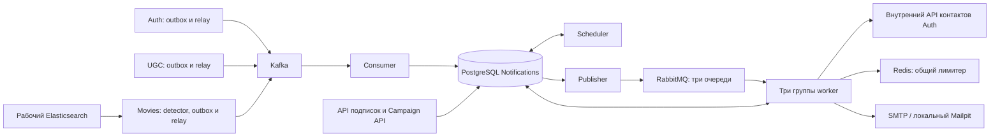

# Notifications

Notifications хранит локальные данные получателей, управляет подписками, формирует
сводные письма за период (дайджесты) и доставляет email. Источники данных:
Auth — сервис учётных записей, UGC — сервис комментариев и голосов,
Movies — сервис каталога фильмов. При подготовке письма Notifications читает
свою базу PostgreSQL с локальными копиями этих данных.

Согласованный контракт: [APPROVED.md](../../docs/diagrams/notifications-arch/APPROVED.md).
Этот README объясняет реализацию и порядок её ревью.

## Содержание

- [Что реализовано](#что-реализовано)
- [Архитектура и процессы](#архитектура-и-процессы)
- [Локальный запуск для ревью](#локальный-запуск-для-ревью)
- [Данные и события](#данные-и-события)
- [Как формируются письма](#как-формируются-письма)
- [Доставка и восстановление](#доставка-и-восстановление)
- [HTTP API](#http-api)
- [Первичная загрузка](#первичная-загрузка)
- [Настройки](#настройки)
- [Проверки и диагностика](#проверки-и-диагностика)
- [Порядок чтения кода](#порядок-чтения-кода)

## Что реализовано

**Подписка** — флаг, которым пользователь разрешает соответствующую рассылку.
**Кампания** — внешняя рассылка выбранным получателям; вызывающий сервис передаёт
её пачками заявок (батчами), по одному письму на получателя в кампании.
**Шаблон** — файл оформления письма, в который подставляют его текст и данные получателя.

| Сценарий | Когда создаётся письмо | Подписка |
| --- | --- | --- |
| Welcome — приветственное письмо | Новая регистрация в Auth | Не требуется |
| Дайджест лайков | По расписанию, если достигнут порог прироста на комментарий | `likes` |
| Новинки каталога | По расписанию, из новых фильмов, ещё не выбранных для рассылки | `new_films` |
| Внешняя кампания | Приём батча через отдельный API | `marketing` для начального шаблона предложений `personal_offer` |

Также реализованы первичная загрузка существующих данных (**bootstrap**) без старых
рассылок, отложенная отправка, повторы после ошибок и учёт результатов кампаний.
Поддерживается канал `email`. Админка менеджера, SMS/push, редактор шаблонов и ручной
перезапуск окончательно неуспешных доставок в текущий объём не входят.

## Архитектура и процессы

### Хранилища и передача данных

| Компонент | Что это и зачем нужен |
| --- | --- |
| PostgreSQL Notifications | База локальных данных, заданий на отправку и их результатов |
| Kafka | Брокер событий: хранит изменения Auth, UGC и Movies до обработки Notifications |
| RabbitMQ | Брокер заданий: хранит очереди сообщений для процессов отправки |
| SMTP-сервер | Почтовый сервер, которому передают готовые письма по протоколу SMTP |
| Mailpit | Локальный SMTP-сервер для ревью: принимает письма и показывает их в браузере |
| Redis | Общее хранилище состояния ограничителя скорости SMTP |
| Elasticsearch | Поисковое хранилище рабочего каталога Movies; источник данных об опубликованных фильмах |

**Лимитер** — общий ограничитель скорости отправки. Перед каждой передачей письма
SMTP-серверу процесс отправки получает у него разрешение. Redis хранит доступный запас
разрешений для почтового аккаунта и его распределение между видами писем.
Если разрешения нет или Redis недоступен, письмо остаётся ждать.

**Outbox** — таблица или коллекция исходящих записей, сохраняемых вместе с изменением
данных. У источников она содержит события для Kafka; в Notifications — ссылки на задания
для RabbitMQ. **Задание (`delivery`)** — отправка одного письма одному получателю.
**Выпуск дайджеста** — сохранённые данные, список получателей и прогресс создания заданий
за один период; сохранённые данные и аудитория называются **снимком выпуска**.

### Отдельные процессы

Каждый процесс запускается своим контейнером. Режимы Notifications используют один код
и одну базу. **JWT Auth** — подписанный токен доступа пользователя, по которому API
проверяет, кто меняет подписки.

| Процесс | Контейнер / сторона | Что делает |
| --- | --- | --- |
| Relay — пересылка событий | Auth, UGC и Movies | Читает outbox своего источника и отправляет события в Kafka |
| Detector — обнаружение фильмов | Movies | Читает рабочий Elasticsearch и записывает новинки и изменения в outbox |
| Обслуживание базы | `notifications-maintenance` | Завершает старые задания без `tz` и очищает содержимое завершённых писем по сроку хранения |
| API подписок | `notifications-api` | Читает и меняет флаги пользователя, проверяя JWT Auth |
| Campaign API — API внешних кампаний | `notifications-campaign-api` | Принимает батчи, проверяя сервисный ключ вызывающего backend |
| Consumer — обработчик событий | `notifications-consumer` | Читает Kafka и обновляет локальные данные; при регистрации создаёт welcome-задание |
| Scheduler — планировщик | `notifications-scheduler` | По расписанию фиксирует выпуск и создаёт задания получателям пачками |
| Publisher — публикация заданий | `notifications-publisher` | Передаёт готовые записи outbox в RabbitMQ с подтверждением публикации |
| Worker — отправитель писем | `notifications-worker-{transactional,service,bulk}` | Получает задание, проверяет допуск, готовит письмо и передаёт его SMTP-серверу |
| Проверка первичной загрузки | `notifications-bootstrap` | Регистрирует и сверяет получение исходного снимка UGC |
| Инициализация лимитера | `notifications-limiter-init` | Создаёт состояние ограничителя с нулевым запасом и паузой перед пополнением |
| Миграция — обновление схемы базы | `notifications-migrate` | Применяет изменения таблиц PostgreSQL перед запуском процессов |

**Класс отправки** определяет очередь RabbitMQ и отдельную группу worker:

| Класс | Очередь | Назначение |
| --- | --- | --- |
| `transactional` | `email.transactional` | Срочные служебные письма, включая welcome |
| `service` | `email.service` | Несрочные уведомления, включая дайджест лайков |
| `bulk` | `email.bulk` | Новинки и массовые кампании |

### Поток данных



Docker Compose — средство запуска описанного набора контейнеров.
Профиль Compose — именованная группа контейнеров, включаемая отдельно.
Scheduler включается профилем `notifications-scheduling`, Campaign API —
`notifications-campaigns`, detector Movies — `notifications-detection`.
Scheduler и detector включают после соответствующей первичной загрузки.
Команды каждого процесса приведены в [справочнике настроек](docs/CONFIGURATION.md#команды-отдельных-процессов).

## Локальный запуск для ревью

### 1. Поднять сервисы и отправить welcome

Нужны Docker и Docker Compose 2.24+. Python и SMTP-аккаунт на хосте не нужны.
Перед отправкой один раз запускается `notifications-limiter-init`: запас разрешений
начинает пополняться после паузы 60 секунд. Без инициализации worker откладывает письма.
Проверочный скрипт `review_smoke.py` регистрирует пользователя и ищет письмо в Mailpit.
Из корня репозитория выполните:

```sh
docker compose --env-file .env.example -p notifications-review up -d --build \
  auth auth-relay notifications-api notifications-consumer notifications-publisher \
  notifications-worker-transactional
docker compose --env-file .env.example -p notifications-review run --rm notifications-limiter-init
docker compose --env-file .env.example -p notifications-review exec -T notifications-api \
  python - < infra/notifications/review_smoke.py
```

| Шаг | Результат |
| --- | --- |
| `up` | Собирает приложения, поднимает зависимости и применяет миграции в отдельном проекте `notifications-review` со своими томами |
| `limiter-init` | Создаёт состояние лимитера; начальная пауза из примера — 60 секунд; повторный запуск сохраняет уже учтённые разрешения |
| `review_smoke.py` | Регистрирует нового пользователя через Auth и до 180 секунд ждёт его welcome в Mailpit |

Ожидаемый результат: `PASS: welcome accepted by Mailpit`.
Каждый запуск проверки создаёт нового тестового пользователя и проходит настоящую цепочку
Auth → outbox/relay → Kafka → Notifications → RabbitMQ → worker → SMTP.
Стенд использует порты 8025 и 9094–9096.

### 2. Открыть письмо в Mailpit

**http://localhost:8025** — интерфейс локального SMTP-сервера Mailpit.
Контейнер `notifications-mailpit` включён в основной Compose. Worker подключается к нему
по адресу `notifications-mailpit:1025` внутри Docker-сети; SMTP-порт на хост не опубликован.

Mailpit сохраняет письма в отдельном томе и показывает адресата, тему и содержимое.
Пересылка во внешние почтовые ящики не настроена. Логин, пароль и TLS локально не нужны;
**`infra/notifications/smtp.env` создавать не требуется**.

### 3. Посмотреть логи или остановить стенд

```sh
docker compose --env-file .env.example -p notifications-review logs --tail=100 \
  auth-relay notifications-consumer notifications-publisher notifications-worker-transactional
docker compose --env-file .env.example -p notifications-review down
```

Остановка сохраняет базы и письма в томах. Порт интерфейса можно изменить через
`NOTIFICATIONS_MAILPIT_UI_PORT`.

Этот короткий запуск проверяет регистрацию и welcome. Для дайджестов и исторических
данных следуйте [порядку первичной загрузки](../../docs/diagrams/notifications-arch/ROLLOUT.md#первичная-загрузка).
Campaign API включается отдельно: [инструкция](docs/CAMPAIGNS.md#запуск-и-доступ).

## Данные и события

### Откуда берутся данные

**Топик** — именованный поток Kafka. Он разделён на **партиции** — независимо читаемые
последовательности сообщений. `event_id` — постоянный идентификатор события,
`user_id`, `review_id`, `film_id` — идентификаторы пользователя, комментария и фильма.
Версии `user_version`, `likes_version`, `film_version` увеличиваются источником при
изменении соответствующих данных; они позволяют отличить новое состояние от старого.

| Источник / топик | События и данные | Что делает Notifications |
| --- | --- | --- |
| Auth / `auth.users.v1` | `user.registered`, `user.profile_updated`, `user.deleted`; `event_id`, `user_id`, `user_version`; `tz` при регистрации и обновлении; обычное обновление только при смене `tz`, без контактов | Создаёт или обновляет локальный профиль только при большей версии; удаление помечает через `deleted_at`, сохраняя данные и отключая флаги |
| UGC / `ugc.reviews.v1` | `review_id`, `user_id` автора, полный `likes_count`, `likes_version`, `event_id` | Хранит один актуальный счётчик на комментарий; отдельные голоса не копирует |
| Movies / `movies.films.v1` | `film.published`, `film.updated`; полный снимок карточки и `film_version` | Обновляет локальную карточку; публикацию один раз учитывает как новинку |

Профиль — локальная запись получателя: `user_id`, версия, часовой пояс (`tz`),
признак удаления и флаги `likes`, `new_films`, `marketing`. Начальные флаги назначаются
при создании профиля; обновление из Auth сохраняет выбор пользователя.

Контакты — email, имя, фамилия и язык — остаются в Auth. Перед первой подготовкой
письма worker запрашивает их через внутренний API Auth с сервисным ключом.
Аудиторию и дневное окно Notifications рассчитывает локально. Контактные изменения
не создают Kafka-события; письмо получает актуальные контакты при подготовке.
Готовое письмо сохраняется для повторов, поэтому временно содержит персональные данные.
После завершения доставки очищаются и готовое письмо (`deliveries.payload`), и исходные
тема и текст внешнего письма (`campaign_recipients.subject`, `text`). Срок задаёт
`NOTIFICATIONS_DELIVERY_PAYLOAD_RETENTION_SECONDS`: для доставок он отсчитывается от
`terminal_at`, для получателей, пропущенных при приёме без создания доставки, — от
`campaign_batches.accepted_at`. Будущая дата отправки не продлевает хранение такого
пропуска. Очистка охватывает также старые доставки с уже удалённым `payload`.
Идентификаторы, результаты и хеши пачек сохраняются: статистика и проверка точных
повторов работают после удаления текста; повторный запрос не восстанавливает его.

Карточка фильма содержит название, описание, дату создания, рейтинг, жанры,
время первой публикации `catalog_published_at` и изменения `catalog_updated_at`. Notifications получает её через Kafka;
рабочий Elasticsearch читает отдельный detector на стороне Movies.
`film.updated` может создать отсутствующую карточку, но не создаёт новинку.
Если обновление пришло раньше публикации, поздняя `film.published` учитывает новинку,
сохраняя более свежую карточку.

### Какие таблицы хранят состояние

Все таблицы ниже находятся в PostgreSQL Notifications; определения — в [db/models.py](src/notifications/db/models.py).

| Таблицы | Назначение |
| --- | --- |
| `profiles` | Идентификатор, версия, часовой пояс, подписки и отметка удаления пользователя |
| `processed_events`, `kafka_offsets` | Обработанные `event_id` и следующая позиция чтения каждой партиции |
| `review_counters`, `pending_reviews` | Счётчики лайков и данные, ожидающие появления профиля автора |
| `film_cards`, `film_announcements` | Карточки и отдельные отметки о новинках |
| `load_state`, `bootstrap_receipts` | Состояние первичной загрузки и подтверждение применения исходных записей |
| `schedule_runs`, `schedule_items`, `schedule_recipients` | Выпуск дайджеста, его состав, аудитория и прогресс |
| `deliveries`, `delivery_items` | Задание одному получателю, его состав, статус и сохранённое письмо |
| `outbox`, `delivery_attempts` | Передача заданий в RabbitMQ и история SMTP-попыток |
| `campaigns`, `campaign_batches`, `campaign_recipients` | Автор кампании, принятые батчи и результаты по всем адресатам |

### Повторы и порядок событий

**Транзакция** сохраняет все входящие в неё изменения вместе; `COMMIT` завершает это
сохранение. **Offset** — позиция сообщения в партиции Kafka.
**Проекция** — локальные данные, полученные обработкой событий источников.
**Группа consumer** объединяет процессы, которые совместно читают партиции для одной проекции.

Consumer одной транзакцией сохраняет `processed_events`, прикладные изменения,
необходимые задания с outbox и следующий offset в `kafka_offsets`.
Сбой до `COMMIT` откатывает всё; при запуске чтение продолжается с позиции из PostgreSQL.
Дополнительно версии пользователя, счётчика и карточки защищают от устаревших событий.

Все consumer одной проекции используют одну группу. Неверный JSON, нарушение схемы события
или пустое значение приостанавливают только соответствующую партицию. Consumer продолжает
читать остальные партиции, включая другие партиции того же топика. Позиция в `kafka_offsets`
не продвигается, оставшиеся сообщения проблемной партиции из полученной пачки не применяются.
В лог уровня ERROR попадают topic, partition, offset и требование ручного исправления;
содержимое события и подробности ошибки валидации не выводятся.

После исправления причины перезапуск consumer повторяет чтение с позиции PostgreSQL.
При перераспределении партиций новый владелец делает то же самое: если событие всё ещё
некорректно, партиция снова приостанавливается. Автоматического пропуска нет.
Недоступность требуемого Kafka offset, ошибки БД и обработчиков по-прежнему останавливают
процесс и требуют устранения причины.

## Как формируются письма

### Welcome

Применённое событие `user.registered` создаёт не более одного welcome-задания на пользователя.
`user.profile_updated`, перенос старых пользователей и повторы регистрации нового письма
не создают. Welcome требует активный профиль и email, но не зависит от флагов рассылок.

### Дайджест лайков

Событие UGC обновляет счётчик; письмо создаёт scheduler. `likes_count` — текущее число
лайков, `last_sent_likes_count` — число из последнего отправленного письма (до первой
отправки — исходное число при загрузке, у нового комментария — 0).
`likes_min_delta` — минимальный прирост для уведомления. Для каждого комментария проверяется:

```text
likes_count - last_sent_likes_count >= likes_min_delta
```

Начальный порог — **3**. Уменьшение или прежнее число лайков уведомления не вызывает,
даже если состав голосовавших изменился. Несколько подходящих комментариев автора
объединяются в одно письмо. Прирост накапливается от последней успешной отправки,
а не обнуляется при ежедневной проверке.

После успеха `last_sent_likes_count` получает значение из отправленного снимка,
`last_notification_sent_at` — время отправки. Пришедшие за это время новые лайки
остаются приростом для следующего выпуска.

### Дайджест новинок

Scheduler выбирает до `NOTIFICATIONS_FILMS_PER_DIGEST` новинок (по умолчанию 20)
и активных подписчиков `new_films`. Выбираются самые свежие по `catalog_published_at`;
при одинаковой дате первым идёт меньший `film_id`. Состав и лимит фиксируются в выпуске
для всех получателей; последующее изменение настройки их не меняет.
Все доступные к границе периода `film_announcements` закрепляются за выпуском,
но только выбранные получают `included_in_digest=true`. Остальные считаются обработанными:
они не отправляются и не переносятся в следующие выпуски, в том числе при пустой аудитории.
Обновления карточки меняют данные для письма, но не создают повторную рассылку.
Worker при первой подготовке читает актуальные карточки одним запросом с лимитом выпуска;
необязательные отсутствующие поля не показывает. Лимит действует и для старых заданий,
ещё не подготовленных к отправке: если лимит выпуска ещё не сохранён, используется
текущая настройка worker. Уже сохранённое письмо на повторе не меняется.

### Выпуск и задания получателям

Scheduler одной транзакцией фиксирует `schedule_runs`, данные и получателей.
Уникальны вместе вид дайджеста (`kind`) и начало периода (`period_start`).
Поздние события и новые подписчики не расширяют уже сохранённый выпуск.

**Курсор аудитории** — сохранённая позиция в списке получателей, до которой задания
уже созданы. Scheduler создаёт задания пачками. В каждой транзакции вместе сохраняются
`delivery`, выбранные для письма данные (`delivery_items`), outbox и курсор.
Уникальность пары «идентификатор выпуска `run_id`, получатель `user_id`»
позволяет продолжить после сбоя без второго задания. Комментарий не резервируется
одновременно для двух незавершённых доставок. Завершение выпуска означает создание
всех заданий; результаты SMTP учитываются отдельно.

### Расписание и дневное окно

**Дневное окно** — разрешённые часы начала отправки по местному времени получателя.
Именованный часовой пояс IANA (например, `Europe/Moscow`) берётся из `tz` профиля.

| Правило | Начальная конфигурация |
| --- | --- |
| Подготовка дайджеста лайков | Раз в сутки, `00:00 UTC` |
| Подготовка новинок | Раз в семь суток, четверг `00:00 UTC` |
| Отправка `service` и `bulk` | `[10:00, 20:00)` в актуальном IANA `tz` получателя |
| Отправка `transactional` | Без дневного окна |

**Точка отсчёта расписания** — дата и время UTC, от которых повторяются периоды.
У лайков и новинок она задаётся отдельно через `NOTIFICATIONS_LIKES_SCHEDULE_ANCHOR_UTC`
и `NOTIFICATIONS_FILMS_SCHEDULE_ANCHOR_UTC`. Начальное значение — `1970-01-01T00:00:00Z`;
для новинок по понедельникам в 09:00 UTC укажите `1970-01-05T09:00:00Z` при периоде 604800.
Рестарт не сдвигает границы. Точка в будущем откладывает первый выпуск до этой даты.

Границы окна задаются через `NOTIFICATIONS_SEND_WINDOW_START` и `NOTIFICATIONS_SEND_WINDOW_END`
в формате `HH:MM`, по умолчанию `10:00` и `20:00`. Начало включается, конец — нет;
начало должно быть раньше конца в пределах одних суток. Например, `08:30` и `18:45`
разрешают дневную отправку с 08:30 до 18:45 по времени получателя.
[Все параметры и применение изменений](docs/CONFIGURATION.md#расписание-и-окно-отправки).
Scheduler назначает допустимое время, а worker снова проверяет окно непосредственно перед SMTP.
Неверный или отсутствующий `tz` означает окончательный пропуск `invalid_timezone` для
`service`/`bulk`: scheduler не создаёт задания, Campaign API учитывает пропуск, worker
завершает уже созданное задание без нового повтора. После исправления пояса доступны
будущие выпуски. Новая регистрация в Auth во всех сценариях требует корректный `tz`;
историческим профилям UTC не подставляется. `FALLBACK_TZ` применяется только к отображению письма.

### Шаблоны

[Реестр шаблонов](src/notifications/template_registry.py)
сопоставляет идентификатор шаблона с файлом и задаёт допустимый канал, класс и подписку.
HTML и темы внутренних писем находятся в [templates/](src/notifications/templates/):
`welcome`, `likes`, `new_films` используют отдельные `*.subject.txt`.
Внешний `personal_offer` получает готовые `subject` и `text` из заявки; HTML экранируется,
переданные выражения не исполняются как шаблон.

## Доставка и восстановление

**Lease** — временное владение записью, защищающее её от одновременной обработки
несколькими процессами. `delivery_id` — идентификатор задания, `available_at` — время,
не раньше которого можно передать его в RabbitMQ, `published_at` — отметка публикации.
**Exchange** направляет сообщения RabbitMQ в очереди; **quorum-очередь** сохраняет
сообщения с согласованием между своими репликами. **DLQ** — отдельная очередь
окончательно неуспешных сообщений. **Message-ID** — идентификатор подготовленного письма.

1. Publisher захватывает готовые записи `outbox` с наступившим `available_at`.
   Обрабатывает ограниченные пачки классов в порядке `transactional`, `service`, `bulk`.
2. Передаёт в RabbitMQ только `delivery_id`. Exchange `notifications.email` направляет
   сообщения в три сохраняемые quorum-очереди. `published_at` записывается только после
   подтверждения брокера и успешной маршрутизации.
3. Worker захватывает delivery и проверяет локальный профиль, подписку и `tz`. При первой
   подготовке получает контакты из Auth вне транзакции с блокировками строк, заново проверяет
   допуск и сохраняет адрес, тему, тело и `Message-ID`. Повторы SMTP используют этот снимок
   без повторного запроса контактов. Недоступность Auth откладывает подготовку без SMTP-попытки;
   отсутствие email или пользователя в Auth завершает задание с причиной пропуска.
4. Перед SMTP worker повторно проверяет допуск и дневное окно, получает разрешение Redis.
   Все экземпляры расходуют общий запас аккаунта и выделенную долю своего класса атомарно.
5. После подтверждения SMTP worker сохраняет результат и только затем подтверждает
   сообщение RabbitMQ (`ack`). Статус `sent` означает приём SMTP-сервером.

| Ситуация | Поведение |
| --- | --- |
| RabbitMQ принял сообщение, publisher не сохранил результат | Повторная публикация с тем же `delivery_id`; worker проверяет состояние задания |
| Временная ошибка SMTP | Результат попытки, `retry`, следующий срок и новый outbox сохраняются одной транзакцией; затем `ack` |
| Окно закрыто, нет лимита или Redis недоступен | Задание откладывается через outbox без SMTP и без расходования попытки |
| Worker упал | Задание восстанавливается после истечения lease; завершённое `sent` повторно не отправляется |
| Постоянная ошибка / исчерпаны попытки | Окончательный результат в PostgreSQL, неуспешное сообщение — в DLQ |
| SMTP мог принять письмо, но подтверждение или commit потеряны | Попытка `uncertain`, `duplicate_risk=true`; возможен дубль с тем же `Message-ID` |

Если worker назначил повтор до сохранения подтверждения предыдущей публикации,
он обновляет неопубликованную запись outbox и сбрасывает её `lease_token` и `lease_until`
в той же транзакции. Publisher проверяет свой токен перед записью результата,
поэтому старое подтверждение не помечает будущий повтор опубликованным.
После наступления `available_at` запись доступна publisher без ожидания восстановления.

SMTP не гарантирует отправку строго один раз (exactly-once). Отложенные задания и повторы ожидают в PostgreSQL,
а не в отдельной очереди таймеров. Удаление профиля или отключение нужной подписки
проверяются и после фиксации аудитории. Отсутствующий email даёт пропуск.

**Recovery** — фоновый цикл поиска незавершённых заданий. При временном сбое БД
он записывает тип ошибки в лог и повторяет проверку после
`NOTIFICATIONS_POLL_SECONDS`, сохраняя активные отправки. Временность определяется
по разрыву соединения, таймауту или коду PostgreSQL; ошибки SQL, ограничений и кода
не считаются временными автоматически.

Если восстановление, чтение очереди или обработчик требует перезапуска, worker сначала
прекращает приём новых заданий и дожидается завершения активных обработчиков.
Они продолжают ждать ответ SMTP, сохранять результат и подтверждать сообщения RabbitMQ;
ошибка подтверждения одного сообщения не отменяет соседние отправки.
Затем ошибки передаются управляющему циклу, который переподключается после паузы.
При SIGTERM/SIGINT действует
`NOTIFICATIONS_SHUTDOWN_TIMEOUT`: по истечении этого времени оставшиеся
обработчики отменяются, а незавершённые попытки позднее восстанавливаются как `uncertain`.

Redis использует token bucket: пополняемый запас разрешений аккаунта и каждого класса.
Неиспользованная доля между классами не передаётся, масштабирование worker не увеличивает
лимит провайдера. Потерянный запас не создаётся автоматически; нужна безопасная
инициализация оператором. [Настройка и сохранность лимитера](docs/CONFIGURATION.md#общий-лимитер-smtp).

Для немедленных `transactional` согласован срок **до 3 минут** от сохранения исходного
события до подтверждения SMTP при исправных компонентах и согласованной нагрузке.
Проверка на фоне bulk, её условия и результаты описаны в
[ROLLOUT](../../docs/diagrams/notifications-arch/ROLLOUT.md#исправления-полного-аудита-11-октября-2026).

## HTTP API

### Подписки пользователя

`notifications.main:create_app` обслуживает API с access JWT Auth:

| Метод | Путь | Назначение |
| --- | --- | --- |
| `GET` | `/api/v1/notifications/preferences/me` | Прочитать три флага |
| `PATCH` | `/api/v1/notifications/preferences/me` | Изменить переданные флаги |

Пример тела PATCH: `{"likes": false, "marketing": true}`. Флаги независимы;
непереданные сохраняются. Отсутствующий профиль возвращает `409`, удалённый — `410`.

**Introspection** — проверка текущего состояния токена в Auth. Перед каждым GET и PATCH
Notifications проверяет JWT локально, затем отправляет его в
`POST /api/v1/internal/introspect` с сервисным ключом `X-Service-Key`.
Auth проверяет отзыв токена и актуальность `session_epoch` — версии состояния сессий
пользователя. После успешного выхода, смены пароля или удаления аккаунта старый токен
получает `401`; до чтения или изменения подписок запрос не доходит.
При недоступности Auth, таймауте или некорректном ответе возвращается `503`, без изменения
подписок. Положительные ответы Auth не кэшируются.

Процесс `api` требует `NOTIFICATIONS_AUTH_INTROSPECTION_URL`,
`NOTIFICATIONS_AUTH_INTROSPECTION_API_KEY` и положительный
`NOTIFICATIONS_AUTH_INTROSPECTION_TIMEOUT_SECONDS`. Compose задаёт URL Auth и берёт
сервисный ключ из `SERVICE_API_KEY`; таймаут указан в `.env.example`.

### Внешние рассылки

`X-API-Key` — HTTP-заголовок с сервисным ключом вызывающего backend.
`notifications.campaigns.app:create_campaign_app` — отдельный HTTP-процесс, проверяющий этот ключ.
Он использует ту же базу и доставку; основной API этих маршрутов не содержит.
Campaign API доступен внутри Compose, без host port и маршрута nginx.

| Метод | Путь | Назначение |
| --- | --- | --- |
| `POST` | `/api/v1/notifications/campaigns/{campaign_id}/batches` | Атомарно принять батч, вернуть `202` после commit |
| `POST` | `/api/v1/notifications/campaigns/{campaign_id}/close` | Закрыть загрузку после сверки ожидаемого числа батчей (`expected_batches`) |
| `GET` | `/api/v1/notifications/campaigns/{campaign_id}` | Автор, состояние загрузки и результаты доставки |

Вызывающий backend выбирает аудиторию, передаёт идентификатор автора (`created_by_user_id`),
готовую тему (`subject`) и текст (`text`) для каждого `user_id`. При приёме Notifications проверяет
локальный профиль, подписку и часовой пояс; контакты запрашивает из Auth при подготовке письма.
Задания обрабатываются после приёма батча с учётом `available_at`;
ожидать `close` для начала отправки не требуется.

`campaign_id` обозначает кампанию, `batch_id` — её батч. Эта пара защищает точный повтор; на одного пользователя допускается
одно письмо в кампании. Изменённый повтор конфликтует. Нет локального профиля — откат
всего батча с `409 profile_not_ready`; выключенная подписка, удалённый профиль или некорректный
часовой пояс учитываются как пропуски отдельных получателей. Отсутствие email (`no_email`)
или недоступный пользователь (`contact_unavailable`) фиксируются позже, при подготовке письма.
Ошибка обращения к Auth вызывает повтор подготовки, а не пропуск получателя.

Статистика включает всех адресатов (`total`): принятые SMTP письма (`sent`), окончательные
ошибки (`failed`), пропуски (`skipped`) и незавершённые задания (`pending`).
Всегда выполняется `total = sent + failed + skipped + pending`.
Итоговый статус появляется после закрытия загрузки и завершения заданий.
[Полный контракт, curl-пример, ошибки и статусы](docs/CAMPAIGNS.md).

## Первичная загрузка

Исторические данные передаются обычным путём outbox → relay → Kafka.
Идентификатор загрузки `load_id` остаётся постоянным; снимки и отметки переноса сохраняются для безопасного повтора.

| Источник | Что переносится | Почему старые уведомления не отправляются |
| --- | --- | --- |
| Auth | Текущие профили через `user.profile_updated`, одна транзакция для всех пользователей | Это событие не создаёт welcome; версии сохраняют более свежие данные и выбранные флаги |
| UGC | Зафиксированные исходные счётчики | Исходное число один раз становится `last_sent_likes_count`; более свежий счётчик не откатывается |
| Movies | Исходный рабочий каталог через `film.updated` и заполнение списка уже известных фильмов `known_films` на стороне Movies | Обновление карточки не создаёт новинку; detector запускается после загрузки |

Scheduler лайков ждёт успешной сверки исходного снимка UGC в Notifications.
Пустой outbox источника не доказывает завершённую обработку в consumer.
Фиксация исходного снимка (`capture`), запись в outbox (`enqueue`), регистрация снимка
в Notifications (`register`), сверка его получения (`finalize`) и порядок включения процессов —
в [ROLLOUT](../../docs/diagrams/notifications-arch/ROLLOUT.md#первичная-загрузка).

## Настройки

Pydantic Settings — библиотека, которая читает и проверяет настройки из переменных
окружения (env). Через неё загружаются настройки сервиса. Корневой [.env.example](../../.env.example)
содержит локальную конфигурацию; [Compose](../../compose.yaml) передаёт её процессам.
Размеры батчей consumer, scheduler, publisher, восстановления worker и Campaign API
задаются через env. Начальные флаги и интервалы — явные обязательные параметры.

[Справочник настроек](docs/CONFIGURATION.md) содержит:

- команды отдельных процессов и обязательные переменные;
- размеры батчей и параметры worker;
- подключение внешнего SMTP через необязательный `infra/notifications/smtp.env`;
- лимиты Redis, инициализацию и масштабирование.

Если используется старый собственный `.env`, замените SMTP host `host.docker.internal`
на `notifications-mailpit` для локальной отправки. Пример содержит демонстрационные лимиты;
для внешнего провайдера задаются его ограничения и данные для авторизации.

## Проверки и диагностика

Для проверок из исходников нужны Python 3.12.12 и менеджер Python-зависимостей `uv`;
точные версии зависимостей закреплены в lock-файлах.
Из корня репозитория:

```sh
docker compose -f tests/notifications/compose.yaml up -d --wait
uv run --directory services/notifications ruff check .
uv run --directory services/notifications ruff format --check .
uv run --directory services/notifications mypy src migrations
uv run --directory tests/notifications python run_service_checks.py notifications
uv run --directory tests/notifications pytest test_contracts.py test_end_to_end.py test_delivery_classes.py test_campaigns_end_to_end.py -q -s
```

| Проверка | Что покрывает |
| --- | --- |
| Короткий сценарий ревью выше | Регистрация через Auth и welcome в Mailpit на основном Compose |
| Проверки сервиса | Обработчики событий, транзакции, bootstrap, scheduler, API, доставка, миграции |
| Контрактные и сквозные (E2E) тесты | Реальные процессы и хранилища, очереди, SMTP и внешние кампании |

Тесты создают базы с уникальными именами, топики, очереди, отдельное состояние лимитера
и индексы в отдельном стенде.
Общие базы приложения не очищаются; недоступная зависимость считается ошибкой.

Для диагностики: [SQL-запросы без контактных данных](../../infra/notifications/metrics.sql).
Для восстановления Redis, смены очередей и отката приложения:
[эксплуатационная инструкция](../../docs/diagrams/notifications-arch/ROLLOUT.md).

## Порядок чтения кода

| Шаг | Файлы | На что смотреть |
| --- | --- | --- |
| 1. Контракт и состояние | [contracts.py](src/notifications/contracts.py), [db/models.py](src/notifications/db/models.py), [migrations/](migrations/) | События, версии, уникальность, таблицы |
| 2. Приём Kafka | [ingest/consumer.py](src/notifications/ingest/consumer.py), [ingest/transactions.py](src/notifications/ingest/transactions.py) | Позиция чтения и транзакция обработки |
| 3. Локальные данные | [profiles/events.py](src/notifications/profiles/events.py), [likes/events.py](src/notifications/likes/events.py), [films/events.py](src/notifications/films/events.py) | Защита от старых версий и правила создания уведомлений |
| 4. Планирование | [scheduling/scheduler.py](src/notifications/scheduling/scheduler.py), [scheduling/windows.py](src/notifications/scheduling/windows.py) | Снимок выпуска, курсор, дневное окно |
| 5. Доставка | [delivery/publisher.py](src/notifications/delivery/publisher.py), [delivery/worker.py](src/notifications/delivery/worker.py), [delivery/smtp.py](src/notifications/delivery/smtp.py) | Lease, подтверждения, повторы и неопределённый результат |
| 6. Ограничение скорости | [delivery/rate_limit.py](src/notifications/delivery/rate_limit.py), [delivery/rate_limit.lua](src/notifications/delivery/rate_limit.lua) | Атомарное списание общего и классового разрешений |
| 7. HTTP | [main.py](src/notifications/main.py), [profiles/api.py](src/notifications/profiles/api.py), [campaigns/app.py](src/notifications/campaigns/app.py), [campaigns/service.py](src/notifications/campaigns/service.py) | Разделение API, приём батча и статистика |
| 8. Конфигурация и письма | [config.py](src/notifications/config.py), [template_registry.py](src/notifications/template_registry.py), [delivery/render.py](src/notifications/delivery/render.py) | Обязательные настройки, выбор шаблона и сохранение содержимого |
